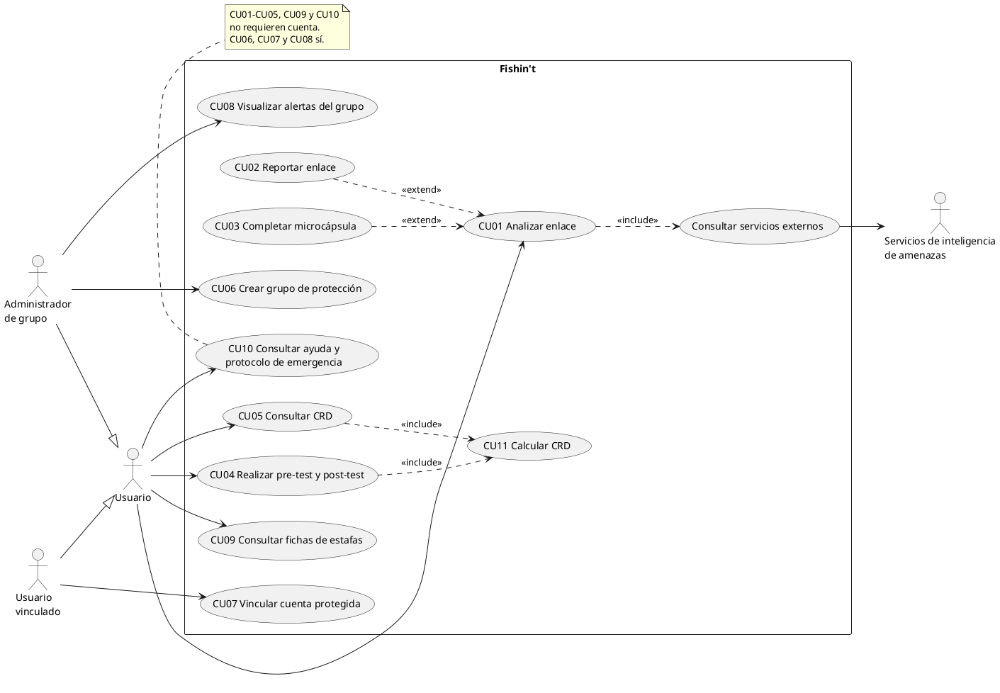
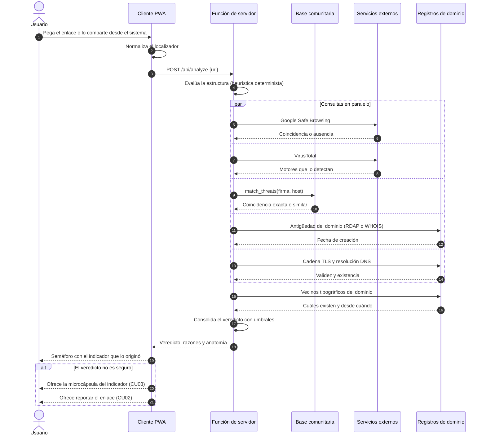
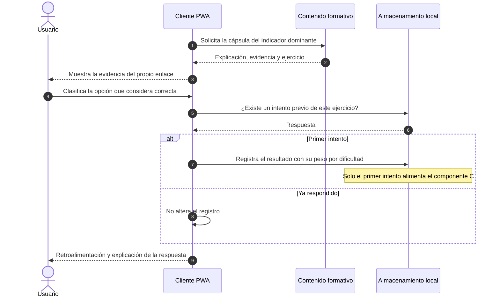
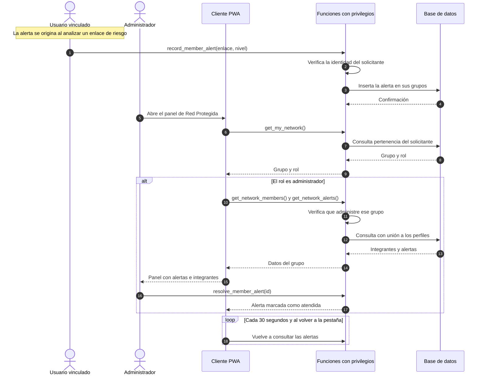

# Guía de aplicación — correcciones al informe final de Fishin't

**Este es el archivo de trabajo.** Contiene las 24 correcciones ordenadas **según el orden del
documento Word**, cada una con qué hacer, dónde, y el texto final listo para pegar. Se trabaja de
arriba hacia abajo.

Son 23 comentarios de la revisión de noviembre de 2026 más una corrección que el profesor no marcó
pero que conviene resolver igual (§4.2.3 a), la afirmación sobre aprendizaje automático).

> `docs/cierre-informe.md` es el **archivo de respaldo**: contiene el razonamiento completo de cada
> corrección, por si hay que defenderla en la presentación. No hace falta abrirlo para aplicar los
> cambios; las referencias «Parte N» de esta guía apuntan ahí.

**Convenciones de esta guía**

| Marca | Significado |
|---|---|
| 🔁 | Reemplazar texto existente |
| ➕ | Agregar texto nuevo |
| ✂️ | Eliminar |
| 🖼️ | Insertar figura |
| ⚠️ | Requiere una decisión tuya |

**Cuatro correcciones ya están aplicadas en el código** y no requieren nada de tu parte salvo que el
texto del informe las refleje: el umbral de VirusTotal (#266), Gemini sin URL completa (#226), la
eliminación del componente D (#149) y el contrabalanceo de las formas del instrumento (#146).

---

## Estado verificado al 13 de noviembre

Auditoría del archivo `Fishint Plataforma Móvil Para Detección(6).docx` (13-nov 16:56), leyendo el
texto vigente. **0 cambios controlados pendientes** y **1 comentario** sin resolver, contra 105
cambios y 23 comentarios de la versión del 8 de noviembre. El equipo aceptó todo y creció el
documento de 1.064 a 1.324 párrafos.

### Resuelto, y en varios casos mejor que lo propuesto aquí

| Tema | Cómo quedó |
|---|---|
| `#214` Matriz metodológica | Híbrido fuera. Tres columnas, totales 2,05 / 3,75 / 4,00 |
| `#273` Web Share en iOS | **Mejor que la propuesta de esta guía**: RNF09 enumera RF01 y RF03–RF16 como equivalentes y acota RF02 a «los navegadores que lo admiten», con RF01 como alternativa en iOS; se agregó método de verificación por plataforma y la restricción se declara en §3.3.1.2 |
| `#127` Punto de equilibrio | Resuelto con rigor: fórmula explícita, supuestos declarados (incluido «por verificar con el proveedor» y «v = 0 no estimado») y análisis de sensibilidad de conversión entre 1 % y 5 % |
| `#125` Licencias | Investigado y citado: §2.8.2 declara que Safe Browsing es de uso no comercial, remite a Web Risk para fines comerciales y exige lenguaje calificado y atribución. Bibliografía con las dos fuentes |
| `#203` Ley 21.719 | Incorporada, y el equipo encontró algo que esta guía no tenía: el proyecto de ley de octubre de 2026 que busca **postergar su entrada en vigencia** |
| `#146` Protocolo | §3.2.5 creado. Muestra de ≥20 (10 por perfil), exclusión del equipo, no generalizabilidad declarada, cuentas con código anónimo, grupo de comparación condicional, resguardos éticos con Anexo 2, y menores excluidos de la validación |
| `#259` Casos de uso | «Figura 3 Diagrama de casos de uso» insertada y numerada |
| **ML en §4.2.3** | Resuelto exactamente por el lado fuerte: la cita de Random Forest / Gradient Boosting queda como estado del arte y §4.2.3 declara «Fishin't no incorpora un modelo de aprendizaje automático entrenado», con la justificación de explicabilidad |

### ⚠️ Regresión: el componente D volvió

§3.2.1 trae otra vez `U = mín(100; 40·mín(A,15)/15 + 30·mín(R,8)/8 + 30·mín(D,10)/10)` y la
definición de D como «10 amenazas detectadas». La corrección de #149 estaba aplicada el 8 de
noviembre y se perdió al reescribir el apartado. Queda además un **doble problema**:

- **El documento contradice al código**, que no tiene D desde el commit `f702600`.
- **El párrafo se contradice consigo mismo**: dice que los topes «fueron definidos empíricamente» y
  tres líneas después que «no cuentan con respaldo empírico». Las dos frases están en el mismo
  párrafo.

El reemplazo está en el Paso 4.5 de esta guía.

### Pendiente de verdad

| Tema | Estado |
|---|---|
| `#280` Resultados | **El más grave.** El capítulo 8 existe, pero es de puesta en marcha, respaldo, mantención y capacitación, no de evidencia. **No hay capítulo 9 ni 10.** Las cifras del motor (94,7 / 72,7 / 86,4) **no aparecen ni una vez** en el documento, de modo que los criterios de §3.2.4 sobre exhaustividad y falsos positivos siguen sin resultados |
| `#277` Secuencias | **Sin resolver.** §7.5.1 a §7.5.3 siguen en pseudotexto de corchetes y flechas. El contenido mejoró y es más fiel al sistema, pero la forma es exactamente la que el comentario rechazó. Lo que sí se corrigió es el estilo de título de §7.5.2 |
| `#269` Diccionario | **Parcial.** Tabla 11 existe y numerada, con columnas Tabla / Clave foránea / Datos / Control de acceso, más dos observaciones de minimización. Faltan los **tipos de dato y las restricciones**, que el comentario pedía expresamente |
| `#146` Contrabalanceo | **Sin resolver.** La palabra no aparece en el documento, y §3.2.3 conserva «ítems distintos pero equivalentes en estructura y dificultad» sin demostrarlo. Es la corrección más barata de todas |
| `#3` Coherencia | §7.4.1 sigue prometiendo compartir «sin copiar ni pegar», sin la salvedad de iOS que sí está en RF02, RNF09 y §3.3.1.2 |
| Comentario abierto | El único que queda es de **forma y severidad alta**: numeración inconsistente, subtítulos con jerarquía equivocada y tabla de contenidos descuadrada. Se resuelve con numeración automática de Word |

### Defectos nuevos, introducidos en esta versión

1. **Encabezado duplicado:** «2.8.5 CANALES» aparece dos veces, con «2.8.6 RIESGOS DEL MODELO» en
   medio.
2. **Número de tabla duplicado:** el punto de equilibrio se rotula «Tabla 3», pero Tabla 3 ya es la
   matriz metodológica de §4.2.2.
3. **§3.2.5 compromete más de lo que existe:** «Banco de enlaces de al menos 100 enlaces por clase».
   Los conjuntos reales tienen 60 maliciosos y 62 legítimos entre ambos. O se baja la cifra, o el
   capítulo de resultados nacerá incumpliendo su propio protocolo.

### Y una decisión que ya no es mía señalarla sino tuya

§2.8.2 mantiene el esquema **freemium** con un «Plan Protegido» de **$2.990 CLP mensuales**,
mientras la aplicación no tiene ninguna función de pago y la decisión que me diste fue que nunca la
tendría. El equipo lo encuadró como «análisis de viabilidad, no plan de ejecución», remitiendo a
§3.3.1.2, y ese encuadre **es defendible** —el capítulo 2 es de modelo de negocio por estructura del
curso—. Pero conviene que sea deliberado y no un residuo: si se conserva, ninguna parte del
documento puede describir el plan de pago como existente en el prototipo.

---

## Paso 0 — Tres decisiones antes de escribir

Estas tres cambian el texto que vas a pegar más adelante. Resuélvelas primero.

### ⚠️ Decisión 1 — ¿Conservas la afirmación del ranking regional? `#21`

El informe dice que Chile «se sitúa de manera persistente en los primeros lugares de los indicadores
regionales», atribuido a «diversos informes de corporaciones de ciberseguridad».

- **Si la conservas:** hay que **buscar la fuente específica** — un informe regional con ranking
  explícito, año y cifra. Citar al CSIRT en general no basta.
- **Si la eliminas (recomendado):** el texto del Paso 2.1 ya está escrito para esa opción. Usa en su
  lugar los 37,7 millones de detecciones de Kaspersky (2025), que el informe **ya cita** en §1.3 y
  §2.7.

### ⚠️ Decisión 2 — ¿Tres fases de IDEO o cinco de Stanford? `#210`

El informe enumera cinco fases (empatía, definición, ideación, prototipado, validación) y las
atribuye a IDEO (2015). IDEO usa **tres**: inspiración, ideación, implementación. Las cinco son del
modelo de *Design Thinking* de la escuela de diseño de Stanford.

- **Tres fases de IDEO (recomendado):** la referencia ya está en la bibliografía, no requiere fuentes
  nuevas. El texto del Paso 5.2 está escrito para esta opción.
- **Cinco fases:** hay que **incorporar la referencia de Stanford**, que el informe hoy no tiene.

### ⚠️ Decisión 3 — ¿Eliminas la frase sobre «los encuestados»? `#28`

- **Si la eliminas (recomendado):** el texto del Paso 2.2 ya está escrito para eso.
- **Si la conservas:** hay que **ubicar el estudio primario** con institución responsable, año,
  tamaño muestral y método, y citarlo directamente — no a través de Central Web, que es el medio que
  lo difundió, no la fuente.

### Lo que NO es decisión

**La fórmula del CRD en §3.2.1 debe actualizarse.** El código ya eliminó el componente D. Si el
texto conserva la fórmula antigua, el documento y el sistema se contradicen, y es el tipo de
inconsistencia que la revisión ya castigó una vez (#3). Está en el Paso 4.5.

---

# Paso 1 — Resumen y Abstract

## 1.1 🔁 Resumen — estado del proyecto `#3`

**Dónde:** la frase final del Resumen.
**Qué dice hoy:** «se construyó un prototipo funcional desplegado, cuya validación […] se reporta en
las entregas siguientes».
**Por qué cambia:** el Resumen y el Abstract se contradicen entre sí —uno dice que el prototipo
existe, el otro que se construirá— y hay cuatro estados distintos declarados a lo largo del
documento. El estado real: **construido, desplegado, motor validado; pruebas con usuarios no
ejecutadas.** (Parte 1 del informe.)

**Texto final:**

> Sobre esa base se construyó un prototipo funcional, desplegado y de acceso público, cuyo motor de
> detección fue evaluado sobre dos conjuntos de enlaces etiquetados. Los resultados de esa evaluación
> se reportan en el capítulo 9. La validación con usuarios mediante pruebas de usabilidad y la
> medición del Coeficiente de Resiliencia Digital en una muestra real no se ejecutaron dentro de este
> período y se declaran como trabajo pendiente.

## 1.2 🔁 Abstract — alinear el tiempo verbal `#3`

**Qué dice hoy:** «Prototype construction and its validation […] **will be carried out** during the
second academic semester of 2026». El error es el tiempo verbal: esa fecha ya pasó.

**Texto final:**

> On that basis a functional prototype was built and publicly deployed, and its detection engine was
> evaluated against two labelled link sets; those results are reported in Chapter 9. User validation
> through usability testing and Digital Resilience Coefficient measurement on a real sample was not
> carried out within this period and is declared as pending work.

---

# Paso 2 — Capítulo 1: planteamiento del problema

## 2.1 🔁 §1.1 — Contexto nacional `#21`

**Qué hacer:** reemplazar el párrafo del ranking regional.
**Por qué:** la atribución es genérica («diversos informes» no es una fuente) y, lo más serio, se
afirma una **causa** —el desajuste en alfabetización digital— que el informe no demuestra. La
corrección la degrada a premisa declarada, que es lo que realmente es. (Parte 10.1.)

**Texto final** (opción «eliminar el ranking», Decisión 1):

> La situación en Chile expone un escenario complejo. Durante 2025, Kaspersky reportó el bloqueo de
> 37,7 millones de intentos de phishing dirigidos a usuarios en el país (Kaspersky, 2025), cifra que
> da cuenta de la magnitud del fenómeno. El presente proyecto parte de la premisa de que esta
> exposición no se explica principalmente por deficiencias de infraestructura tecnológica, sino por
> una brecha en la alfabetización digital de la población: mientras las instituciones financieras y
> las grandes organizaciones capacitan sistemáticamente a su personal, los usuarios particulares
> carecen de formación equivalente. Esta premisa orienta el diseño de la solución y su validación
> empírica queda fuera del alcance de este trabajo.

> El cambio decisivo es **«parte de la premisa»** en lugar de afirmarlo. Una premisa declarada no
> exige prueba; una afirmación causal sí.

## 2.2 ✂️ §1.3 — La frase sobre «los encuestados» `#28`

**Qué hacer:** eliminar «La gran mayoría de los encuestados manifestó haber sido destinatario de
enlaces fraudulentos o haber resultado afectado por alguna estafa informática (Central Web, 2026)».
**Por qué:** no identifica encuesta, muestra ni instrumento, y Central Web es un medio, no la fuente
primaria. La oración anterior ya trae un dato sólido con fuente; esta no agrega evidencia y sí agrega
una vulnerabilidad — es el tipo de afirmación que se desmonta pidiendo la ficha técnica.

**Texto final del párrafo completo:**

> ¿Cuánto sucede? Se trata de una problemática de alcance masivo: solo durante 2025, Kaspersky
> reportó el bloqueo de 37,7 millones de intentos de phishing dirigidos a usuarios en Chile
> (Kaspersky, 2025). Esa magnitud evidencia un estado de exposición generalizado y la falta de
> herramientas de verificación accesibles en el momento en que el usuario enfrenta el enlace.

---

# Paso 3 — Capítulo 2: marco teórico y factibilidad

## 3.1 🔁 §2.5.2 — Fechar la frase del prototipo `#3`

**Qué dice hoy:** «al momento de elaborar este análisis el prototipo se encontraba en fase de
diseño».
**Por qué:** la frase es correcta en su contexto, pero sin fechar se lee como el estado actual.

**Texto final:**

> al momento de elaborar **este análisis comparativo**, durante la fase de diseño, el prototipo aún
> no se había construido

## 3.2 🔁 §2.7.3 — «Consume mínimos recursos de hardware» `#116`

**Qué hacer:** reemplazar el párrafo.
**Por qué:** «demuestra» exige evidencia y ninguno de los tres recursos (batería, procesamiento,
datos) fue medido. Este es el único comentario donde **no hay que moderar: se puede medir**. Las
cifras salen de ejecutar `npm run build`. (Parte 10.3.)

**Las cifras medidas:**

| Vista | Carga inicial |
|---|---|
| Código compartido por toda la aplicación | 87,4 kB |
| Vista más liviana | 88,2 kB |
| Vista del analizador (la más pesada) | 154 kB |
| Mediana de las vistas | ≈ 140 kB |

**Texto final:**

> El sistema integra servicios de inteligencia de amenazas y un motor heurístico propio dentro de un
> cliente deliberadamente liviano. La carga inicial de la vista más pesada —el analizador de
> enlaces— alcanza 154 kB, con 87,4 kB de código compartido por toda la aplicación. A diferencia de
> las suites de seguridad convencionales analizadas en §1.3.1, cuya principal limitación operativa es
> el consumo de recursos del dispositivo, la solución no requiere instalación de un paquete nativo ni
> mantiene procesos residentes: el análisis se ejecuta en el servidor y el cliente solo opera
> mientras el usuario lo utiliza. El consumo de batería y de datos móviles en uso sostenido no fue
> medido y se identifica como trabajo pendiente.

> La última frase es la que vuelve el párrafo defendible: **declara lo que no se midió**. El resto son
> cifras reproducibles.

## 3.3 🔁 §2.8 — De modelo de negocio a modelo de sostenibilidad `#125` `#127`

**Qué hacer:** reemplazar el apartado de modelo de negocio, incluidas las tarifas y el punto de
equilibrio.
**Por qué:** #125 era el comentario **crítico** de toda la revisión — los niveles gratuitos de Google
Safe Browsing y VirusTotal **prohíben el uso comercial**, de modo que un modelo freemium sobre esas
API incumpliría sus términos. La decisión de que el proyecto sea gratuito y no comercial lo resuelve
de raíz. Y al no haber ingresos, #127 (punto de equilibrio sin supuestos) **desaparece**: no hay
punto de equilibrio que calcular.

**Texto final:**

> **Modelo de sostenibilidad.** El proyecto se define como una solución de acceso gratuito y sin
> fines comerciales. Esta decisión responde a dos razones concurrentes.
>
> La primera es de pertinencia: el segmento al que se dirige la solución —personas con competencias
> digitales básicas, microempresas y adultos mayores— es precisamente el que una barrera de pago
> excluiría, de modo que cobrar por la herramienta contradiría el objetivo del proyecto.
>
> La segunda es de cumplimiento. Los servicios de inteligencia de amenazas que el sistema integra,
> Google Safe Browsing y VirusTotal, ofrecen niveles de acceso gratuito cuyos términos de uso
> **prohíben expresamente la explotación comercial**. Un modelo de suscripción construido sobre
> ellos habría requerido licenciamiento comercial, con costos incompatibles con un proyecto
> académico. El carácter no comercial de la solución no es, por tanto, una limitación del modelo,
> sino la condición que hace lícito su uso de estos servicios.
>
> La operación se sostiene sobre los niveles gratuitos de los servicios de infraestructura empleados
> —alojamiento sin servidor, base de datos gestionada y las API de inteligencia de amenazas—, cuyos
> límites de consumo son holgados para el volumen de un prototipo. Un despliegue a escala masiva
> requeriría financiamiento institucional o de fondos públicos de ciberseguridad, vía que se declara
> como condición para la continuidad del proyecto y no como ingreso proyectado.
>
> El producto se estructura en dos modalidades, ambas gratuitas: **Consulta**, que no requiere
> cuenta y comprende el analizador de enlaces, el núcleo formativo y el reporte comunitario; y
> **Red**, que requiere cuenta por vincular identidades y comprende el módulo de seguridad delegada.

> **Revisa también** si el informe menciona «premium», «freemium», «suscripción» o «plan de pago» en
> otros apartados — resumen, §1.4, conclusiones. Ver el Paso 10.

---

# Paso 4 — Capítulo 3: objetivos, instrumento y criterios

## 4.1 🔁 §3.1.1 — Objetivo general `#3` `#139`

**Por qué:** dos correcciones en una. #139 pide un solo verbo y máximo tres renglones; #3 exige que
desaparezca el futuro «se construirá durante el segundo semestre de 2026», que ya quedó en pasado.

**Texto final:**

> Validar un prototipo funcional del sistema Fishin't —cliente web progresivo y servicio backend—
> que integra detección heurística de enlaces, alfabetización digital gamificada y seguridad
> delegada, para reducir la vulnerabilidad frente al phishing en usuarios chilenos con competencias
> digitales básicas.

## 4.2 🔁 Objetivos específicos — un verbo cada uno `#139` `#143` `#145`

**Por qué:** b), c) y d) empiezan con «Diseñar e implementar», que son dos verbos. El diseño de los
tres módulos ya está en los capítulos 5 a 7, así que lo que el objetivo compromete es la
construcción.

| | Hoy | Texto final |
|---|---|---|
| a) | Diagnosticar… | **Diagnosticar** — sin cambios |
| b) | ~~Diseñar e implementar~~ el motor de análisis heurístico | **Implementar** el motor de análisis heurístico de enlaces (URL Analyzer) |
| c) | ~~Diseñar e implementar~~ el núcleo pedagógico | **Construir** el núcleo pedagógico gamificado (Cyber-Academy) |
| d) | ~~Diseñar e implementar~~ el módulo de seguridad delegada | **Desarrollar** el módulo de seguridad delegada (Red Protegida) |
| e) | Validar… | **Validar** — el verbo está bien, pero el cuerpo arrastra el mismo problema |

**Cuerpo del objetivo e) — texto final** (hoy dice «Evaluar la usabilidad […] **y medir** la
efectividad pedagógica»):

> Validar el prototipo funcional integrado mediante pruebas con usuarios y evaluación técnica. La
> validación comprende tres mediciones: usabilidad del cliente web mediante el instrumento System
> Usability Scale, desempeño del motor de detección sobre conjuntos etiquetados, y efectividad
> pedagógica mediante la variación del Coeficiente de Resiliencia Digital conforme a los criterios de
> la sección 3.2.

## 4.3 ✂️🔁 Objetivo b) — frase duplicada y conjunto sin especificar `#144`

### a) ✂️ La frase duplicada

El texto actual **repite palabra por palabra** un fragmento completo:

> …y ~~evaluar su desempeño mediante las métricas de precisión, exhaustividad y tasa de falsos
> positivos~~ sobre un conjunto controlado de enlaces y **evaluar su desempeño mediante las métricas
> de precisión, exhaustividad y tasa de falsos positivos** construido a partir de repositorios
> públicos…

Es un error de edición. Elimina la segunda aparición.

### b) 🔁 Texto final del objetivo b)

> **Implementar** el motor de análisis heurístico de enlaces (URL Analyzer).
>
> Construir un algoritmo de clasificación que combine reglas heurísticas propias sobre la estructura
> de la URL con consultas a servicios externos de inteligencia de amenazas (Google Safe Browsing y
> VirusTotal) y con una base comunitaria de firmas alimentada por los reportes de los usuarios,
> orientado a los patrones de fraude del escenario chileno, y evaluar su desempeño mediante las
> métricas de precisión, exhaustividad y tasa de falsos positivos sobre dos conjuntos etiquetados
> independientes, cuya composición se especifica en la sección 3.2.4.

## 4.4 ➕ §3.2.4 — Especificación del conjunto de evaluación `#144`

**Por qué:** el comentario pide fuentes concretas, tamaño, proporción y fecha de captura. Como la
evaluación **ya se ejecutó**, estos datos son reales y no proyectados.

| | Conjunto de afinamiento | Conjunto de validación |
|---|---|---|
| Tamaño | 77 enlaces | 45 enlaces |
| Proporción fraude / legítimo | 38 / 39 | 22 / 23 |
| Proporción nacional / internacional | 69 / 8 | 41 / 4 |
| Fecha de captura | Octubre 2026 | Noviembre 2026 |

**Texto final a continuación de la tabla:**

> **Fuentes.** Los enlaces legítimos son dominios oficiales reales de instituciones chilenas,
> seleccionados entre las entidades suplantadas con mayor frecuencia (banca, Servicio de Impuestos
> Internos, administradoras de fondos de pensiones, empresas de reparto, casas comerciales y
> organismos públicos), incluyendo deliberadamente instituciones fuera de la lista blanca del motor.
> Los enlaces fraudulentos se construyeron a partir de las tipologías de campañas chilenas
> documentadas en el corpus del objetivo a).
>
> **Independencia entre conjuntos.** El segundo conjunto se construyó con un criterio de muestreo
> distinto y sin reutilizar ninguna institución del primero, de modo que permita estimar el sesgo
> introducido por el ajuste de los indicadores sobre el primer conjunto.
>
> **Limitación declarada.** Los enlaces fraudulentos son casos curados, no capturas en vivo de un
> repositorio público verificado. La incorporación de una muestra de ese tipo queda como trabajo
> pendiente y así se reporta en §9.5.

**➕ Criterio de éxito que falta.** §3.2.4 fija umbrales para exhaustividad y falsos positivos pero
no para la precisión, pese a que el objetivo b) la compromete:

> Precisión igual o superior al 90 % sobre el conjunto de validación, de modo que a lo más uno de
> cada diez enlaces marcados como amenaza resulte ser legítimo.

El valor medido es 100 %, así que se cumple con holgura. Fijarlo igualmente es necesario para que la
métrica sea evaluable y no meramente informativa.

## 4.5 ✅ §3.2.1 — La fórmula del CRD: eliminar el componente D `#149`

> ✅ **Ya aplicado en el documento** (verificado sobre el archivo guardado el 8 de noviembre a las
> 22:51). §3.2.1 ya trae la fórmula sin D, la definición de variables sin D y el párrafo de
> «parámetros de diseño establecidos por juicio experto». Aparecen como **cambios controlados**, no
> como texto plano — ver el cierre del Paso 10.
>
> Lo que sigue queda como referencia: la formulación completa en un solo lugar, por si hay que
> defenderla en la presentación o verificar que el documento y el código coinciden.

**Por qué — y esta es la objeción más de fondo de toda la revisión:** el componente D **no mide
resiliencia, mide exposición**. La fórmula original era

> U = mín(100; 40·mín(A,15)/15 + 30·mín(R,8)/8 + 30·mín(D,10)/10)

donde A son los enlaces analizados, R las amenazas reportadas y D las amenazas detectadas. A y R son
**conductas**: la persona decide analizar y decide reportar. D no lo es — cuenta cuántos de los
enlaces que analizó resultaron peligrosos, y eso depende de qué le llegó al teléfono.

Dos usuarios con conducta idéntica —quince enlaces analizados cada uno— obtienen puntajes distintos
si a uno le llegaron diez estafas y al otro ninguna. **El indicador premia haber sido blanco de
delincuentes**, que es lo contrario de lo que pretende medir. No es un problema de calibración sino
de validez de constructo.

### Cómo queda la formulación completa

Esto es lo que debe aparecer en §3.2.1. Las tres expresiones corresponden exactamente a lo
implementado en el código, así que el documento y el sistema quedan consistentes.

**Indicador global**

> **CRD = 10 · (0,65 · C + 0,35 · U)**,  con CRD ∈ [0, 1000]

donde **C** es el componente de conocimiento y **U** el componente de uso, ambos expresados en una
escala de 0 a 100.

**Componente de conocimiento (C)** — porcentaje de acierto ponderado por dificultad:

> **C = 100 · ( Σᵢ wᵢ · xᵢ ) / ( Σᵢ wᵢ )**

- La sumatoria recorre los ítems **efectivamente respondidos** por la persona.
- **wᵢ** es el peso por nivel de dificultad del ítem: básico = 1, intermedio = 2, avanzado = 3.
- **xᵢ** = 1 si la respuesta fue correcta, 0 en caso contrario.
- Se conserva **únicamente el primer intento** de cada ítem; los reintentos posteriores no
  modifican C, de modo que el componente mide conocimiento y no persistencia.
- Si la persona no ha respondido ningún ítem, C = 0.

**Componente de uso (U)** — conductas preventivas, con tope por actividad:

> **U = 55 · mín(A, 15) / 15 + 45 · mín(R, 8) / 8**

- **A** = número de enlaces analizados.
- **R** = número de amenazas reportadas.
- Los topes de 15 y 8 ya acotan U al intervalo [0, 100], de modo que no se requiere una restricción
  adicional sobre la suma.

**Escala de interpretación** (sin cambios: el rango de U sigue siendo [0, 100], así que los cortes
no requieren recalibración):

| Puntaje CRD | Nivel |
|---|---|
| 0 – 399 | Vulnerable |
| 400 – 599 | En formación |
| 600 – 799 | Resiliente |
| 800 – 1000 | Experto |

### Qué cambió, exactamente

| | Antes | Ahora |
|---|---|---|
| Componente de uso | U = mín(100; 40·mín(A,15)/15 + **30·mín(R,8)/8** + **30·mín(D,10)/10**) | U = 55·mín(A,15)/15 + 45·mín(R,8)/8 |
| Variables | A (analizados), R (reportados), **D (detectados)** | A (analizados), R (reportados) |
| Ponderación interna | 40 / 30 / 30 | **55 / 45** |
| Indicador global | CRD = 10·(0,65·C + 0,35·U) | **sin cambios** |
| Escala | 4 niveles, cortes en 400 / 600 / 800 | **sin cambios** |

Solo se modifica la definición interna de U. El indicador global, la ponderación 65/35 y la escala
quedan intactos, que es precisamente la ventaja de redistribuir el peso de D en lugar de eliminarlo
sin reemplazo: no hay que recalibrar nada.

La ponderación **55 / 45** reconoce que analizar es la conducta preventiva básica, accesible a
cualquier usuario, mientras que reportar exige una iniciativa adicional y beneficia a terceros.

### Ejemplo de cálculo, para incluir en el informe

Un usuario que ha respondido ejercicios con 75 % de acierto ponderado, ha analizado 10 enlaces y ha
reportado 3 amenazas:

> U = 55 · (10/15) + 45 · (3/8) = 36,67 + 16,88 = **53,54**
>
> CRD = 10 · (0,65 · 75 + 0,35 · 53,54) = 10 · (48,75 + 18,74) = **675** → nivel *Resiliente*

### Y por qué el criterio de §3.2.4 debe aplicarse sobre ΔC

En la aplicación inicial del instrumento **U = 0 por definición**, porque la persona aún no ha usado
la herramienta. Eso tiene una consecuencia aritmética que conviene declarar: el componente de uso
puede aportar por sí solo hasta

> 10 · 0,35 · 100 = **350 puntos**

de variación, más del doble del umbral de 150 que fija §3.2.4. Un usuario que respondiera 100 % en
ambas aplicaciones —es decir, **sin aprendizaje alguno**, ΔC = 0— «cumpliría» el criterio solo por
haber usado la aplicación. Está comprobado empíricamente en el sistema.

La medida que sí evidencia aprendizaje es la ganancia de conocimiento aislada:

> **ΔC = C_post − C_pre**,  y su contribución al indicador es 10 · 0,65 · ΔC = **6,5 · ΔC**

Por eso el sistema reporta ΔCRD y ΔC como dos cifras distintas.

> ✅ **Esto ya está en el documento, como texto vigente y sin marcas de cambio.** §3.2.4 enuncia el
> criterio sobre ΔC con un umbral de **15 puntos porcentuales**, equivalente a 97,5 puntos de CRD
> (= 6,5 · 15), e incluye la justificación aritmética completa con el caso del participante que
> responde 12/12 en ambas aplicaciones. **No hay que cambiar nada ahí.**

**➕ Texto final sobre los topes y las ponderaciones** (el comentario también pedía justificarlos; la
respuesta honesta es que no hay con qué, y el propio comentario ofrece la salida):

> Los topes de cada actividad (quince enlaces analizados y ocho amenazas reportadas) y las
> ponderaciones entre componentes (65 % conocimiento y 35 % uso) constituyen **parámetros de diseño
> establecidos por juicio experto**, no derivados de evidencia empírica previa. Su función es doble:
> evitar que la repetición mecánica de una misma acción domine el indicador, y expresar la premisa
> central del proyecto, según la cual la resiliencia descansa principalmente en la competencia
> adquirida por la persona y solo de manera complementaria en su uso de la herramienta. Se declaran
> explícitamente como parámetros sujetos a calibración: su ajuste requiere datos de uso real que este
> trabajo no alcanzó a recoger, y constituye una línea de trabajo posterior.

## 4.6 ➕ §3.2 — El protocolo de validación `#146`

### Dónde va: en un apartado nuevo, §3.2.5

**Es agregar, no reemplazar.** Se verificó contra el documento: §3.2 tiene hoy cuatro apartados
—3.2.1 componentes y fórmula, 3.2.2 escala, 3.2.3 instrumento, 3.2.4 criterios de éxito— y **ninguno
contiene protocolo de validación**. No hay tamaño de muestra, criterio de selección, diseño,
contrabalanceo ni resguardos éticos. Lo único que existe es la frase del objetivo e), «a una muestra
de usuarios con distintos niveles de competencia digital», que enuncia la intención sin especificar
nada.

Por eso el protocolo va como un apartado nuevo:

> **3.2.5 PROTOCOLO DE VALIDACIÓN**

**No renumeres los apartados existentes.** El documento referencia «3.2.4» desde otras secciones —al
menos desde los criterios de aceptación del capítulo de requerimientos—, así que insertar el
protocolo como 3.2.4 y correr los criterios a 3.2.5 rompería esas referencias. Agregarlo al final es
limpio y no toca nada.

### Qué es adición y qué toca texto existente

| Bloque | Acción | Texto afectado hoy |
|---|---|---|
| a) Muestra | ➕ Agregar | Nada. Solo la frase vaga del objetivo e), que este bloque concreta |
| b) Grupo control / diseño preexperimental | ➕ Agregar | Nada |
| c) Contrabalanceo | ➕ Agregar en §3.2.5 **y** 🔁 ajustar una frase de §3.2.3 (ver abajo) |
| d) Consentimiento y ética | ➕ Agregar | Nada |
| e) Declarar que no se ejecutó | ➕ Agregar al cierre | Nada |

### 🔁 El ajuste en §3.2.3

§3.2.3 dice hoy que la medición se realiza «mediante dos aplicaciones del mismo instrumento, **con
ítems distintos pero equivalentes en estructura y dificultad**». Esa es una **afirmación de
equivalencia que el documento no demuestra**, y es exactamente el punto que el comentario #146
señala. Reemplázala por:

> La medición se realiza mediante dos aplicaciones del mismo instrumento, con ítems distintos
> construidos bajo idéntica estructura —cuatro ítems de cada nivel de dificultad, con la misma
> ponderación— y a partir de las mismas tipologías de suplantación. La equivalencia de dificultad
> entre ambas formas no fue establecida psicométricamente; el diseño controla ese riesgo mediante el
> contrabalanceo de su orden de administración, especificado en 3.2.5.

> Es el movimiento clave: en lugar de **afirmar** la equivalencia, se declara que no está demostrada
> y se explica el mecanismo que vuelve innecesario demostrarla. Una afirmación no probada es
> atacable; un factor de confusión controlado por diseño, no.

### Los cinco bloques de §3.2.5

Agrega estos cinco bloques en este orden.

### a) ➕ Tamaño y criterio de selección de la muestra

> La validación contempla un muestreo intencionado, no probabilístico, de entre doce y dieciséis
> participantes distribuidos en los dos perfiles definidos en §2.2.1.

| Estrato | Perfil | Participantes |
|---|---|---|
| 1 | Personas de 55 años o más, con uso de banca digital | 6 a 8 |
| 2 | Usuarios financieros emergentes, 18 a 35 años | 6 a 8 |

> El rango responde al instrumento SUS, cuyo promedio se estabiliza razonablemente a partir de una
> docena de respuestas. Se declara expresamente que se trata de una muestra pequeña y no
> probabilística: permite caracterizar la experiencia de uso, no generalizar a la población.

### b) ➕ Grupo control — declarar el diseño por su nombre

**Por qué:** el comentario es exacto. Un diseño pre-post sin control no permite atribuir el cambio al
módulo formativo, porque el efecto de práctica —haber respondido antes un instrumento parecido—
produce mejoras por sí solo. Pero con doce a dieciséis personas, dividir en dos grupos deja seis u
ocho por rama: añadir un control no rescataría la causalidad, solo daría **la apariencia** de un
experimento que la muestra no sostiene.

> El diseño de validación corresponde a un **diseño preexperimental de un solo grupo con medición
> antes y después**. Se reconocen expresamente las amenazas a la validez interna que ello implica:
> efecto de práctica derivado de la familiaridad con el instrumento, maduración de los participantes
> e instrumentación. En consecuencia, la variación observada en el Coeficiente de Resiliencia Digital
> se reporta como resultado **descriptivo** y no se atribuye causalmente al módulo formativo. Un
> diseño con grupo control y muestra suficiente para inferencia estadística queda como línea de
> trabajo posterior.

> Esta es la opción honesta. Un diseño preexperimental declarado como tal es metodológicamente
> aceptable en un trabajo de prototipo; uno presentado como experimental sin serlo, no.

### c) ➕ Equivalencia de las formas pre y post — contrabalanceo

**Por qué — hallazgo de la revisión del código:** el sistema administraba **siempre** la forma A como
pre-test y la forma B como post-test, en orden fijo. Si una de las dos resulta más fácil, esa
diferencia queda **perfectamente confundida** con el aprendizaje que se pretende medir. Ya está
corregido en el código.

> Las dos formas del instrumento comparten estructura —cuatro ítems de cada nivel de dificultad, con
> idéntica ponderación— y fueron construidas sobre las mismas tipologías de suplantación, lo que
> respalda su equivalencia de contenido. Para controlar cualquier diferencia residual de dificultad,
> la asignación de formas se **contrabalancea**: a la mitad de los participantes, determinada
> aleatoriamente, se administra la forma A como medición inicial y la forma B como final; a la otra
> mitad, el orden inverso. Con ello, una eventual asimetría entre formas se distribuye entre ambos
> momentos y deja de confundirse con el efecto formativo.

> Es la corrección más rentable de esta sección: no cuesta nada, no requiere participantes
> adicionales y elimina un factor de confusión que de otro modo invalidaría la medición.

### d) ➕ Consentimiento informado y resguardos éticos

> La aplicación del instrumento contempla los siguientes resguardos, con particular atención al
> estrato de personas mayores:
>
> - **Consentimiento informado por escrito**, en lenguaje sencillo y sin tecnicismos, que indique el
>   propósito del estudio, qué datos se registran, la duración de la sesión y quién tendrá acceso a
>   los resultados.
> - **Participación voluntaria con derecho a retiro** en cualquier momento y sin expresión de causa,
>   incluyendo el retiro de los datos ya entregados.
> - **Anonimización**: los resultados se analizan de forma agregada y no se vinculan a la identidad
>   de los participantes.
> - **Minimización**: no se recogen datos sensibles ni información que exceda lo necesario para las
>   dos mediciones.
> - **Acompañamiento durante la sesión**, enunciando explícitamente que lo evaluado es la
>   herramienta y no la persona, de modo que ningún participante quede expuesto a la sensación de
>   estar siendo examinado.

> Estos resguardos conectan con las obligaciones de la Ley 21.719 del Paso 5.1: el registro del
> consentimiento es una de las brechas de cumplimiento allí declaradas.

### e) ➕ Cierre: el protocolo no se ejecutó

Por coherencia con §9.6, debe quedar claro que esto especifica cómo se **realizaría** la validación,
no cómo se realizó.

> El protocolo de validación aquí especificado no alcanzó a ejecutarse dentro del período del
> proyecto. El instrumento de medición se encuentra construido y operativo —veinticuatro ítems
> distribuidos en dos formas equivalentes—, pero no fue administrado a una muestra de participantes.
> En consecuencia, los criterios de éxito definidos en §3.2.4 relativos a variación del Coeficiente
> de Resiliencia Digital, ascenso de nivel y puntaje SUS no cuentan con evidencia de cumplimiento. Su
> aplicación conforme al protocolo descrito constituye la primera línea de trabajo posterior.

---

# Paso 5 — Capítulo 4: marco legal, metodología y factibilidad

## 5.1 🔁 §4.2.1 — Marco legal: la Ley 21.719 `#203`

> ⚠️ **Advertencia que conviene conservar en el informe:** esto es orientación general, no asesoría
> jurídica. El texto vigente debe verificarse en la Biblioteca del Congreso Nacional y conviene
> revisión de un especialista en derecho de datos. **El informe no debe declarar que la aplicación
> «cumple la ley»**: debe indicar qué obligaciones aborda y cuáles no.

**Por qué:** §4.2.1 fundamenta el tratamiento de datos en la **Ley 19.628**, de 1999. Esa ley está
siendo reemplazada por la **Ley 21.719**, publicada el 13 de diciembre de 2024 y con **entrada en
plena vigencia el 1 de diciembre de 2026** — antes del cierre del año académico en que se presenta
este informe. La nueva ley se alinea con el RGPD europeo, crea la Agencia de Protección de Datos
Personales con facultades de fiscalización y sanción, y contempla multas de hasta 20.000 UTM, o hasta
el 4 % de los ingresos anuales en reincidencia grave.

Afecta de lleno a la Red Protegida por tres razones: trata datos de terceros y no solo del titular de
la cuenta; el público objetivo incluye personas mayores y **menores de edad**, categoría con
protección reforzada; y genera un registro conductual persistente.

**Texto final:**

> El tratamiento de datos personales en Chile se rige por la Ley N.º 19.628 sobre protección de la
> vida privada, actualmente en proceso de reemplazo por la **Ley N.º 21.719**, publicada el 13 de
> diciembre de 2024 y con entrada en plena vigencia el 1 de diciembre de 2026. Esta última reforma
> íntegramente el régimen anterior, se alinea con el estándar del Reglamento General de Protección de
> Datos europeo y crea la Agencia de Protección de Datos Personales con facultades de fiscalización y
> sanción.
>
> El diseño de Fishin't se orientó por el estándar de la nueva ley y no solo por el de la norma que
> reemplaza, dado que su entrada en vigencia es anterior al despliegue previsto de la solución. El
> módulo Red Protegida concentra las exigencias más altas, por tratar datos conductuales de terceros
> dentro de un público que incluye personas mayores y menores de edad, categoría esta última sujeta a
> protección reforzada.
>
> La arquitectura aborda los principios de minimización y finalidad (la Red no almacena datos
> personales propios y las alertas registran únicamente el enlace, su nivel de riesgo y la fecha), la
> incorporación mediante acto positivo del titular, la transparencia hacia la persona supervisada
> —que accede a sus propias alertas, de modo que no existe supervisión oculta—, el derecho de
> supresión y el control de acceso por fila.
>
> Quedan fuera del alcance de esta versión, y se declaran como limitaciones de cumplimiento, el
> registro formal de consentimiento, la verificación de edad y el consentimiento del representante
> legal para personas menores de edad, la portabilidad de los datos del titular, el procedimiento de
> detección y notificación de brechas, el registro de auditoría de accesos y la evaluación sobre la
> necesidad de designar un delegado de protección de datos. Su implementación es condición previa a
> cualquier despliegue en producción con usuarios reales y requiere revisión jurídica especializada.

> **El último párrafo es el que conviene no suavizar.** Un prototipo académico puede tener brechas de
> cumplimiento declaradas; lo que no puede es afirmar que cumple.

## 5.2 🔁 §4.2.2 — Las fases del HCD `#210`

**Dos errores.** El primero es gramatical: «**Estructurar** su ejecución en cinco fases» es
infinitivo y deja la oración sin verbo conjugado → «**Estructura**».

El segundo es de atribución, y es de fondo: las cinco fases enumeradas son del modelo de *Design
Thinking* de Stanford, no de la guía de IDEO que el informe cita. *The Field Guide to Human-Centered
Design* (IDEO, 2015) organiza el proceso en **tres** fases. Se está citando una fuente que dice otra
cosa.

**Texto final** (opción tres fases, Decisión 2):

> Diseño Centrado en el Humano (Human-Centered Design, HCD): metodología de innovación que modela
> soluciones a partir del análisis profundo de las necesidades de las personas. Estructura su
> ejecución en tres fases sucesivas —inspiración, ideación e implementación—, en las que la
> comprensión del contexto precede a la definición de la solución y el prototipado se somete
> iterativamente a la validación de los propios usuarios (IDEO, 2015). Constituye un enfoque de alta
> idoneidad para aplicaciones orientadas a mitigar brechas de alfabetización digital, donde la
> arquitectura de la experiencia de usuario determina la tasa de adopción.

> **Revisa también §5.2 y la nota de la Figura 1**, que citan a IDEO (2015) para el enfoque general.
> Esas menciones son correctas, pero verifica que ninguna repita el esquema de cinco fases.

## 5.3 🔁 Tabla 3 — La matriz de selección metodológica `#214`

**Por qué — es el comentario metodológicamente más serio:** la tabla compara cuatro columnas
—Cascada, SCRUM, HCD e Híbrido— y a la del híbrido le asigna, en cada criterio, **el máximo de sus
dos componentes**:

| Criterio | Peso | Cascada | SCRUM | HCD | Híbrido |
|---|---|---|---|---|---|
| Validación constante con el usuario | 25 % | 1 | 3 | 5 | **5** |
| Capacidad de adaptación al cambio | 20 % | 1 | 5 | 4 | **5** |

Construida así, **la columna del híbrido no puede perder**: por definición vale lo mismo que el mejor
de sus componentes en cada fila. Que obtenga el puntaje más alto no es un hallazgo, es una
consecuencia aritmética de cómo se llenó la tabla. Peor aún, en rigor documental el híbrido recibe un
4, **superior a ambos componentes**, lo que es indefendible sin describir el mecanismo de sinergia
que lo produce. Y la matriz no registra **ningún costo de integración**.

### 🔁 Qué hacer: sacar el híbrido de la matriz

No es una cuarta alternativa, es una síntesis de dos de ellas. Ponerla a competir contra sus propios
componentes es un error de categoría. La tabla final tiene **tres** columnas:

| Criterio | Peso | Cascada | SCRUM | HCD |
|---|---|---|---|---|
| Validación constante con el usuario | 25 % | 1 | 3 | **5** |
| Capacidad de adaptación al cambio | 20 % | 1 | **5** | 4 |
| Viabilidad en equipos reducidos | 15 % | *conservar* | *conservar* | *conservar* |
| Rigor en documentación académica | 15 % | *conservar* | *conservar* | *conservar* |
| Idoneidad para interfaces móviles | 15 % | *conservar* | *conservar* | *conservar* |
| Gestión de requerimientos evolutivos | 10 % | *conservar* | *conservar* | *conservar* |

**Y el argumento queda más fuerte, no más débil.**

**Texto final del párrafo de cierre:**

> El resultado descarta el modelo en cascada, cuya única fortaleza relevante es el rigor documental,
> insuficiente frente al peso conjunto de la validación con usuarios y la adaptación al cambio. Entre
> los dos marcos restantes, la matriz no arroja un ganador único sino un **perfil de fortalezas
> complementarias**: SCRUM domina los criterios de adaptación y cadencia de construcción, mientras
> que el Diseño Centrado en el Humano domina la validación con usuarios, que concentra el mayor peso
> por ser el que sostiene el objetivo específico de mayor exigencia. Ninguno de los dos cubre por sí
> solo el conjunto de criterios.
>
> Esa complementariedad —y no un puntaje superior, que una combinación obtendría por construcción— es
> lo que fundamenta adoptar una estrategia híbrida. La decisión no es gratuita: integrar ambos marcos
> impone costos de coordinación, duplicación de instancias de planificación y una carga adicional
> sobre un equipo de tres integrantes que debe asumir simultáneamente los roles del marco ágil y el
> trabajo de campo del enfoque centrado en el humano. Esos costos se asumen deliberadamente, por
> considerarse menores que el riesgo de renunciar a la validación temprana con usuarios o a la
> capacidad de adaptación durante el ciclo.

> El párrafo final cambia la naturaleza del argumento: pasa de «el híbrido puntuó más» a «los marcos
> son complementarios y asumimos el costo de integrarlos». Lo segundo es una decisión de ingeniería
> fundamentada; lo primero era una tautología.

## 5.4 🔁 §4.2.3 a) — La afirmación sobre aprendizaje automático

> **Este no es uno de los 23 comentarios.** El profesor no lo marcó, pero es la afirmación más
> riesgosa que queda en el documento: se verifica abriendo el repositorio.

**Qué dice hoy:** tras citar Random Forest, redes neuronales y Gradient Boosting, el texto afirma que
«Fishin't integra estas capacidades analíticas».

**El problema:** **no existe ningún modelo entrenado en el sistema.** El motor es determinista y
basado en reglas. La única IA presente es generativa (Gemini) y redacta la explicación del veredicto
ya calculado — no clasifica.

**La corrección se hace por el lado fuerte, no disculpándose.** La cita de la literatura se conserva;
lo que cambia es el sujeto de la oración. Un motor basado en reglas es **defendible como aporte**,
porque §2.4.1.a exige comunicar al usuario qué indicador activó la alerta, y eso un clasificador
estadístico no lo satisface sin explicabilidad añadida.

**Texto final:**

> La literatura sobre detección automatizada de phishing documenta ampliamente el uso de algoritmos
> de aprendizaje supervisado —Random Forest, redes neuronales y Gradient Boosting— aplicados a
> conjuntos de características extraídas de la estructura de la URL, con desempeños reportados
> elevados sobre conjuntos de prueba.
>
> El presente proyecto **no incorpora un modelo de aprendizaje automático entrenado**, y la decisión
> es deliberada. La especificación de §2.4.1.a establece que cada veredicto debe comunicar al usuario
> **qué indicador concreto** activó la alerta, por ser esa explicación —y no la clasificación en sí—
> el componente formativo de la intervención. Un clasificador estadístico entrega una probabilidad,
> no una razón: satisfacer ese requisito exigiría incorporar técnicas de explicabilidad posteriores
> que añaden complejidad sin mejorar la comprensión de un usuario con competencias digitales básicas.
>
> El motor implementado es, por tanto, determinista y basado en reglas, de modo que la razón del
> veredicto **es la regla misma**: cada señal que resta puntaje tiene un enunciado en lenguaje natural
> asociado y una evidencia extraída del propio enlace. La inteligencia artificial generativa se
> emplea en una única función acotada y opcional: redactar en lenguaje accesible la explicación de un
> veredicto previamente calculado por el motor determinista. No participa en la clasificación.
>
> La incorporación de un clasificador entrenado sobre un corpus de campañas chilenas etiquetadas,
> complementario al motor de reglas y sujeto a la misma exigencia de explicabilidad, se identifica
> como línea de trabajo posterior.

> **Busca en todo el documento** antes de entregar: «aprendizaje automático», «machine learning»,
> «Random Forest», «redes neuronales», «Gradient Boosting», «modelo entrenado», «entrenado». Ver el
> Paso 10.

## 5.5 🔁 §4.2.3 — El dato que parecía debilitar la decisión de PWA `#239`

**Por qué — el comentario más agudo de la revisión:** el texto usa un dato —solo la mitad de las
personas mayores de 60 años posee teléfono inteligente (Observatorio del Envejecimiento UC–Confuturo,
2024)— para justificar una PWA **móvil**. Pero si la mitad del segmento prioritario no tiene
smartphone, una aplicación móvil no les llega. **El dato, tal como está empleado, argumenta en
contra de la decisión.**

Tiene razón, y el argumento está mal construido. Pero la decisión técnica sí es defendible: lo que
falla es el razonamiento. Dos hechos lo sostienen.

1. **Una PWA no es una aplicación móvil: es una aplicación web.** Corre en cualquier navegador,
   incluido el de un computador de escritorio. Para la mitad del segmento sin smartphone la PWA sigue
   siendo alcanzable; una aplicación nativa compilada para iOS y Android **no lo sería**. Leído
   correctamente, el dato es un argumento **a favor** de la web.
2. **La arquitectura ya contempla que parte del segmento no opere la tecnología por sí mismo.** Ese
   es el propósito de la Red Protegida (§2.4.1.b).

**Texto final:**

> En primer lugar, elimina la barrera de instalación: el acceso mediante navegador evita la búsqueda,
> descarga y concesión de permisos en una tienda de aplicaciones. Esta decisión adquiere particular
> relevancia a la luz de la cobertura real del segmento prioritario: solo alrededor de la mitad de
> las personas mayores de 60 años en Chile posee un teléfono inteligente y un 21 % maneja ClaveÚnica
> (Observatorio del Envejecimiento UC–Confuturo, 2024). Lejos de debilitar la elección, ese dato la
> fundamenta: una aplicación web progresiva se ejecuta en cualquier navegador, incluido el de un
> equipo de escritorio, mientras que un desarrollo nativo compilado para iOS y Android habría
> excluido por completo a la fracción del segmento que no dispone de teléfono inteligente. A ello se
> suma que el módulo Red Protegida (§2.4.1.b) no presupone que cada persona mayor opere la
> herramienta: contempla que lo haga el integrante del grupo con mayor competencia digital.

> **Ajuste de coherencia:** si la cobertura de escritorio es parte del argumento, revisa que el
> informe no describa la solución como «exclusivamente móvil» en otros apartados. El diseño es
> *mobile-first*, que no es lo mismo que *solo móvil*.

---

# Paso 6 — Capítulo 5: arquitectura

## 6.1 ➕ §5.1 — Transmisión de la URL a servicios externos `#226`

**Por qué:** las consultas a Safe Browsing y VirusTotal transmiten la URL **completa**, y la ruta y
los parámetros pueden contener identificadores de sesión o datos personales. Esto **no se puede
resolver por diseño**: la coincidencia exacta de Safe Browsing depende de la URL íntegra — se verificó
empíricamente que **suprimir la barra final anula la detección**. Hay una tensión real entre capacidad
de detección y minimización de datos, y corresponde declararla, no ocultarla.

**Lo que sí se corrigió en el código:** Gemini ya **no** recibe la URL. Recibe solo la anatomía (host,
TLD, acortador, marca imitada, señales detectadas), que es toda la información que necesita para
redactar la explicación.

**Texto final:**

> El principio de minimización se aplica de forma diferenciada según el destinatario de cada consulta.
>
> El enriquecimiento mediante inteligencia artificial generativa recibe únicamente la **anatomía** del
> enlace —dominio, terminación, presencia de acortador, marca suplantada identificada y conjunto de
> señales activadas—, nunca el localizador completo, dado que la ruta y los parámetros de consulta
> pueden contener identificadores de sesión o datos personales y no son necesarios para redactar la
> explicación.
>
> Las consultas a los servicios de inteligencia de amenazas, en cambio, **requieren transmitir el
> localizador íntegro**: la detección de Google Safe Browsing opera por coincidencia exacta contra su
> lista, y se verificó que la supresión de un solo carácter —la barra final del localizador— anula la
> coincidencia. Existe por tanto una tensión irreducible entre capacidad de detección y minimización
> de datos en este punto, que se declara como limitación del diseño: el usuario que analiza un enlace
> transmite su contenido completo a dos proveedores externos, cuyas políticas de retención no están
> bajo control del proyecto. Una versión posterior podría mitigarla mediante el mecanismo de
> prefijos cifrados que ofrece la propia interfaz de Safe Browsing, a costa de una implementación
> considerablemente más compleja.

---

# Paso 7 — Capítulo 6: requerimientos y casos de uso

## 7.1 🔁 RF02 y RNF09 — La limitación de iOS `#273`

**Por qué:** el profesor observa que Web Share Target no es compatible con Safari en iOS, de modo que
RF02 y RNF09 no se cumplen en esa plataforma. Es exacto, y conviene formularlo con la distinción
precisa, porque son **dos tecnologías distintas con nombres parecidos**:

- **Web Share API** (`navigator.share`): permite que una página **envíe** contenido al menú de
  compartir del sistema. Safari en iOS **sí** la implementa.
- **Web Share Target**: permite que una aplicación web instalada **se registre como destino** del
  menú de compartir. Safari en iOS **no** la implementa; es una capacidad de los navegadores basados
  en Chromium sobre Android y ChromeOS.

Fishin't usa la segunda. En iOS la declaración del manifiesto simplemente se ignora: no produce error,
pero la aplicación nunca aparece en el menú de compartir.

**Qué se pierde y qué no.** La función de analizar enlaces está **plenamente disponible en iOS**: el
campo de pegado es la vía de entrada principal en todas las plataformas y produce exactamente el mismo
análisis. Lo que se pierde es la vía de **menor fricción**: dos toques en Android frente a cuatro
pasos en iOS. Para un público de competencias digitales básicas eso no es trivial. Atenúa el impacto
que **RF02 tiene prioridad Media**, no Alta: el propio proyecto lo clasificó como conveniencia.

### ➕ RF02 — agregar una restricción a la ficha del requerimiento

> **Restricción.** Disponible en navegadores basados en Chromium sobre Android y ChromeOS. No
> disponible en Safari sobre iOS, que no implementa Web Share Target. En esa plataforma la entrada se
> realiza mediante pegado directo del enlace, que es la vía principal en todas las plataformas.

### 🔁 RNF09 — el problema está en una palabra

Hoy exige «operación **equivalente** en Android, iOS y navegadores de escritorio desde una única base
de código». Tal como está, la limitación lo incumple.

**Texto final:**

> **RNF09 — Compatibilidad.** Disponibilidad del conjunto completo de funcionalidades en Android, iOS
> y navegadores de escritorio desde una única base de código. Se exceptúa la recepción por el menú
> «Compartir» del sistema (RF02), cuya tecnología habilitante no está implementada en Safari sobre
> iOS; en esa plataforma la misma funcionalidad se alcanza mediante el ingreso manual del enlace, que
> es la vía de entrada principal en todas las plataformas.

> El cambio de «operación equivalente» a «disponibilidad del conjunto completo de funcionalidades, con
> la excepción declarada» convierte un requisito incumplido en uno cumplido con salvedad explícita. No
> es un recurso retórico: describe con exactitud lo que el sistema hace.

**En la sección de interfaces externas** el informe ya dice «sujeta al soporte del navegador y del
sistema». Conviene **nombrar la plataforma concreta** en lugar de dejarlo como condición genérica: el
evaluador ya identificó cuál es.

**Sobre mitigaciones.** iOS permite al usuario crear un atajo propio que aparece en el menú de
compartir. Es funcional, pero exige configuración manual, lo que lo vuelve inviable para este
segmento. Corresponde declararlo como posibilidad existente, no como parte de la solución entregada.

> **No requiere cambio de código.** Se revisó la interfaz: ninguna vista promete la función de
> compartir. Un usuario de iOS no recibe una promesa incumplida, simplemente no ve una opción que en
> su plataforma no existe. La declaración del manifiesto se mantiene: en iOS es ignorada sin efecto
> y en Android habilita la función.

## 7.2 ➕🔁 §6.4.2 — Tres correcciones al modelo de casos de uso `#259`

Antes de insertar el diagrama hay que resolver tres inconsistencias.

### a) ➕ El «include» apunta a algo que no existe

El texto declara que CU04 y CU05 hacen «include» del *cálculo del CRD*, pero ese cálculo **no está
definido como caso de uso**, y un «include» solo puede apuntar a otro caso de uso. Defínelo:

> **CU11 Calcular Coeficiente de Resiliencia Digital.** Caso de uso incluido, no invocado
> directamente por ningún actor. Combina el componente de conocimiento, obtenido de los ejercicios de
> clasificación, con el componente de uso, derivado de la actividad registrada.

### b) 🔁 CU10 describe una función que ya no existe

El modelo define «CU10 Contactar operador (asistencia humana y con IA)». **Esa funcionalidad fue
eliminada del producto**: no hay chat con IA ni mesa de ayuda, porque el proyecto es gratuito y sin
ingresos. Lo que quedó en su lugar es el protocolo de emergencia de la Ley N° 20.009 y las preguntas
frecuentes.

Conviene **renombrar en lugar de eliminar**, para no alterar la numeración que otras secciones
referencian:

> **CU10 Consultar ayuda y protocolo de emergencia.** El usuario accede a los pasos a seguir si fue
> víctima de una estafa y a las preguntas frecuentes. No requiere cuenta.

### c) 🔁 La frase sobre qué requiere cuenta quedó desactualizada

El texto dice que CU06, CU07, CU08 **y CU10** exigen cuenta. Con la eliminación del operador, la única
funcionalidad ligada a la identidad es la Red Protegida.

> CU01 a CU05, CU09 y CU10 se ejecutan sin cuenta. CU06, CU07 y CU08 la requieren, por operar sobre
> vínculos entre personas identificadas.

## 7.3 🖼️ §6.4.2 — Diagrama de casos de uso `#259`

**Qué hacer:** reemplazar el enunciado en prosa por una figura numerada. Pega este texto en
**plantuml.com/plantuml** y descarga el PNG o SVG.



> **Dos precisiones de notación**, por si las revisan: las flechas de «extend» apuntan **desde** el
> caso extensor **hacia** el caso base —CU02 y CU03 extienden a CU01, no al revés—, y CU11 no recibe
> flecha de ningún actor porque es un caso incluido, nunca invocado directamente.

---

# Paso 8 — Capítulo 7: diseño

## 8.1 🖼️➕ §7.3.1 — Diccionario de datos `#269`

**Qué hacer:** reemplazar la imagen actual (que no tiene número, título ni fuente) por una figura
numerada, e **incorporar el diccionario completo**, que hoy falta.

Todo lo que sigue se generó leyendo los tres archivos de esquema del repositorio (`schema.sql`,
`threat_signatures.sql`, `protected_networks.sql`), de modo que cada tipo, restricción y clave es
verificable contra el código fuente.

La base de datos comprende **siete tablas** en el esquema `public`, más `auth.users`, administrada por
el proveedor de autenticación, a la que las demás referencian.

### 🖼️ Figura — Modelo de relaciones

Pega este texto en **mermaid.live** y descarga la imagen.

```mermaid
erDiagram
    auth_users ||--o| profiles : "tiene perfil"
    auth_users ||--o{ url_scans : "registra"
    auth_users ||--o{ reports : "emite"
    auth_users ||--o{ protected_networks : "administra"
    auth_users ||--o{ network_members : "integra"
    auth_users ||--o{ member_alerts : "origina"
    protected_networks ||--o{ network_members : "agrupa"
    protected_networks ||--o{ member_alerts : "recibe"

    profiles {
        uuid id PK_FK
        text name
        text email
        text phone
        int crd_score
    }
    threat_signatures {
        uuid id PK
        text normalized_url UK
        text host
        text signature
        int report_count
    }
    protected_networks {
        uuid id PK
        text name
        uuid admin_id FK
        text invite_code UK
    }
    network_members {
        uuid id PK
        uuid network_id FK
        uuid user_id FK
        text role
    }
    member_alerts {
        uuid id PK
        uuid network_id FK
        uuid member_id FK
        text url
        text risk_level
        bool resolved
    }
```

> `threat_signatures` no mantiene relación formal con las demás tablas: es un repositorio comunitario
> cuyas filas no pertenecen a ningún usuario, decisión deliberada que se explica más abajo.

### Tablas

#### profiles — datos de perfil del usuario

Extiende `auth.users` con la información que la aplicación necesita mostrar. Se crea automáticamente
al registrarse, mediante el disparador descrito más abajo.

| Columna | Tipo | Nulo | Predeterminado | Restricciones |
|---|---|---|---|---|
| id | UUID | No | — | PK; FK → `auth.users(id)` ON DELETE CASCADE |
| name | TEXT | No | — | — |
| email | TEXT | No | — | — |
| avatar_url | TEXT | Sí | — | — |
| phone | TEXT | Sí | — | Visible para el administrador de la red que integra |
| birth_date | DATE | Sí | — | — |
| crd_score | INTEGER | No | 500 | CHECK entre 0 y 1000 |
| created_at | TIMESTAMPTZ | No | NOW() | — |
| updated_at | TIMESTAMPTZ | No | NOW() | — |

#### url_scans — historial de análisis

| Columna | Tipo | Nulo | Predeterminado | Restricciones |
|---|---|---|---|---|
| id | UUID | No | uuid_generate_v4() | PK |
| user_id | UUID | Sí | — | FK → `auth.users(id)` ON DELETE CASCADE |
| url | TEXT | No | — | — |
| risk_score | INTEGER | No | — | CHECK entre 0 y 1000 |
| risk_level | TEXT | No | — | CHECK ∈ {safe, suspicious, dangerous} |
| reasons | JSONB | Sí | `[]` | — |
| metadata | JSONB | Sí | `{}` | — |
| created_at | TIMESTAMPTZ | No | NOW() | — |

#### reports — reportes de amenazas

| Columna | Tipo | Nulo | Predeterminado | Restricciones |
|---|---|---|---|---|
| id | UUID | No | uuid_generate_v4() | PK |
| user_id | UUID | Sí | — | FK → `auth.users(id)` ON DELETE SET NULL |
| url | TEXT | No | — | — |
| type | TEXT | No | — | CHECK ∈ {phishing, smishing, vishing, scam} |
| description | TEXT | Sí | — | — |
| status | TEXT | No | `pending` | CHECK ∈ {pending, confirmed, rejected} |
| created_at | TIMESTAMPTZ | No | NOW() | — |
| updated_at | TIMESTAMPTZ | No | NOW() | — |

El borrado de la cuenta pone `user_id` en nulo en lugar de eliminar la fila: el reporte ya benefició a
la comunidad y su valor no depende de quién lo emitió.

#### threat_signatures — base comunitaria de firmas

| Columna | Tipo | Nulo | Predeterminado | Restricciones |
|---|---|---|---|---|
| id | UUID | No | uuid_generate_v4() | PK |
| normalized_url | TEXT | No | — | **UNIQUE** |
| url | TEXT | No | — | — |
| host | TEXT | No | — | Indexado |
| signature | TEXT | No | — | Indexado; permite hallar enlaces estructuralmente similares |
| anatomy | JSONB | Sí | `{}` | — |
| risk_level | TEXT | No | `suspicious` | CHECK ∈ {safe, suspicious, dangerous} |
| score | INTEGER | No | 1 | CHECK entre 1 y 7 |
| report_count | INTEGER | No | 1 | Se incrementa en cada reporte del mismo enlace |
| created_at | TIMESTAMPTZ | No | NOW() | — |
| updated_at | TIMESTAMPTZ | No | NOW() | — |

La unicidad de `normalized_url` es lo que permite el comportamiento acumulativo: reportar un enlace ya
existente no duplica la fila, sino que incrementa su contador.

#### protected_networks — grupos de protección

| Columna | Tipo | Nulo | Predeterminado | Restricciones |
|---|---|---|---|---|
| id | UUID | No | uuid_generate_v4() | PK |
| name | TEXT | No | — | — |
| admin_id | UUID | No | — | FK → `auth.users(id)` ON DELETE CASCADE; indexado |
| invite_code | TEXT | No | — | **UNIQUE**; seis caracteres |
| created_at | TIMESTAMPTZ | No | NOW() | — |

#### network_members — pertenencia a un grupo

| Columna | Tipo | Nulo | Predeterminado | Restricciones |
|---|---|---|---|---|
| id | UUID | No | uuid_generate_v4() | PK |
| network_id | UUID | No | — | FK → `protected_networks(id)` ON DELETE CASCADE; indexado |
| user_id | UUID | No | — | FK → `auth.users(id)` ON DELETE CASCADE; indexado |
| role | TEXT | No | `protegido` | CHECK ∈ {admin, protegido} |
| display_name | TEXT | Sí | — | Solo respaldo; el nombre se lee de `profiles` |
| created_at | TIMESTAMPTZ | No | NOW() | — |
| — | — | — | — | **UNIQUE (network_id, user_id)**: impide duplicar la pertenencia |

#### member_alerts — alertas generadas por una persona protegida

| Columna | Tipo | Nulo | Predeterminado | Restricciones |
|---|---|---|---|---|
| id | UUID | No | uuid_generate_v4() | PK |
| network_id | UUID | No | — | FK → `protected_networks(id)` ON DELETE CASCADE |
| member_id | UUID | Sí | — | FK → `auth.users(id)` ON DELETE SET NULL |
| member_name | TEXT | Sí | — | Solo respaldo cuando la cuenta ya no existe |
| url | TEXT | No | — | — |
| risk_level | TEXT | No | — | CHECK ∈ {safe, suspicious, dangerous} |
| resolved | BOOLEAN | No | FALSE | — |
| created_at | TIMESTAMPTZ | No | NOW() | Indexado junto a `network_id`, en orden descendente |

### Índices

| Índice | Tabla | Columnas | Consulta que optimiza |
|---|---|---|---|
| idx_url_scans_user_id | url_scans | user_id | Historial de un usuario |
| idx_url_scans_created_at | url_scans | created_at DESC | Análisis recientes |
| idx_reports_user_id | reports | user_id | Reportes de un usuario |
| idx_reports_status | reports | status | Reportes por estado de revisión |
| idx_threat_host | threat_signatures | host | Coincidencia por dominio |
| idx_threat_signature | threat_signatures | signature | Coincidencia por estructura |
| idx_network_admin | protected_networks | admin_id | Redes que administra un usuario |
| idx_member_user | network_members | user_id | Grupos a los que pertenece |
| idx_member_network | network_members | network_id | Integrantes de un grupo |
| idx_alert_network | member_alerts | network_id, created_at DESC | Panel de alertas del administrador |

### Seguridad a nivel de fila

Las **siete** tablas tienen activado el control de acceso por fila, pero el tratamiento sigue dos
estrategias distintas y la diferencia es deliberada.

**Estrategia A — políticas declarativas** (tablas del esquema base):

| Tabla | Política | Efecto |
|---|---|---|
| profiles | Users can view own profile | Cada usuario lee solo su perfil |
| profiles | Users can update own profile | Cada usuario modifica solo su perfil |
| url_scans | Users can view own scans | Cada usuario lee solo sus análisis |
| url_scans | Users can create own scans | Solo puede insertar los propios |
| reports | Authenticated users can create reports | Cualquier autenticado puede reportar |
| reports | Users can view own reports | Cada usuario lee solo sus reportes |
| threat_signatures | Threat signatures are public to read | **Lectura pública**: el analizador consulta la base comunitaria sin sesión |

**Estrategia B — sin políticas de lectura directa** (tablas de la Red Protegida):
`protected_networks`, `network_members` y `member_alerts` tienen el control activado pero **no declaran
políticas de SELECT**. Todo el acceso ocurre a través de funciones con privilegios de definidor que
verifican internamente la identidad de quien llama.

La razón es técnica y vale explicitarla: una política sobre `network_members` que consultara
`protected_networks` para decidir el acceso, combinada con una política sobre `protected_networks` que
consultara `network_members`, produce una recursión mutua que el motor no puede resolver. Concentrar la
verificación dentro de funciones evita ese ciclo y mantiene la lógica de autorización en un solo lugar
auditable.

### Funciones almacenadas y disparador

Todas se ejecutan con privilegios de definidor y verifican internamente la identidad del solicitante.

| Función | Parámetros | Propósito |
|---|---|---|
| handle_new_user | — | **Disparador** sobre `auth.users`: crea el perfil al registrarse |
| register_threat | url, normalized, host, signature, risk_level, score, anatomy | Inserta o incrementa una firma comunitaria |
| match_threats | normalized, signature, host | Devuelve coincidencia exacta o estructuralmente similar |
| gen_invite_code | — | Genera un código de invitación de seis caracteres |
| create_protected_network | name | Crea el grupo y registra al creador como administrador |
| join_protected_network | code, name | Incorpora al solicitante como persona protegida |
| get_my_network | — | Devuelve el grupo del solicitante y su rol |
| get_network_members | network_id | Integrantes, solo para el administrador del grupo |
| get_network_alerts | network_id | Alertas del grupo, solo para su administrador |
| get_my_alerts | — | Alertas propias de la persona protegida |
| record_member_alert | url, risk, name | Registra una alerta en los grupos del solicitante |
| resolve_member_alert | alert_id | Marca una alerta como atendida |
| leave_protected_network | network_id | Abandona el grupo y elimina sus alertas |
| remove_network_member | network_id, user_id | Retira a un integrante, solo el administrador |
| delete_protected_network | network_id | Elimina el grupo completo |

El disparador `on_auth_user_created` se ejecuta después de cada inserción en `auth.users`.

### ➕ Estado de uso: lo declarado frente a lo utilizado

**Esta subsección conviene no omitirla.** Un diccionario que enumere estructuras sin indicar si se
usan induce a error, y declarar que algo está definido pero no utilizado es preferible a presentarlo
como parte operativa del sistema.

| Estructura | Estado |
|---|---|
| profiles | **En uso.** Lectura y escritura directa desde el cliente |
| reports | **En uso.** Inserción al reportar |
| threat_signatures | **En uso**, exclusivamente a través de `register_threat` y `match_threats` |
| protected_networks, network_members, member_alerts | **En uso**, exclusivamente a través de sus funciones |
| **url_scans** | **Declarada y no utilizada.** El historial de análisis no se persiste |
| profiles.crd_score | **Reservada.** El coeficiente se calcula en el cliente y no se guarda |
| profiles.birth_date, profiles.avatar_url | **Declaradas y no utilizadas** |

**Texto final sobre `url_scans`:**

> La tabla `url_scans`, sus dos índices y sus dos políticas de acceso se encuentran definidos, pero
> ninguna vista de la aplicación escribe en ella: el resultado de cada análisis se muestra al usuario
> y se descarta, y los contadores de actividad residen en el almacenamiento local del navegador. Esto
> tiene dos consecuencias que corresponde declarar.
>
> Primero, el componente de uso del Coeficiente de Resiliencia Digital se calcula sobre datos locales,
> de modo que no sobrevive a un cambio de dispositivo ni al borrado de los datos del navegador.
> Segundo, no existe un historial de análisis consultable por el usuario.
>
> Persistir los análisis es una decisión abierta y no meramente una omisión: hacerlo mejoraría la
> continuidad del indicador, pero construiría un registro de la navegación de cada persona, lo que
> tensiona el principio de minimización declarado en esta misma sección y las obligaciones descritas
> en §4.2.1. Si se adopta, debe acompañarse del consentimiento correspondiente y de una política de
> retención.

## 8.2 🖼️ §7.5 — Diagramas de secuencia `#277`

**Qué hacer:** reemplazar el pseudotexto por tres diagramas UML. §6.4.3 comprometió este nivel de
detalle para CU01, CU03 y CU08. Pega cada bloque en **mermaid.live**.

> El comentario también señala que **§7.5.2 debe recibir estilo de título**. No lo olvides.

### 🖼️ Figura — Secuencia CU01: Analizar enlace sospechoso



> La consulta de vecinos tipográficos aparece **después** del bloque paralelo porque depende de la
> antigüedad obtenida en él: solo se ejecuta si el dominio es reciente o de antigüedad desconocida.

### 🖼️ Figura — Secuencia CU03: Completar microcápsula



### 🖼️ Figura — Secuencia CU08: Visualizar alertas del grupo



> El bucle final documenta el refresco automático: una alerta que apareciera media hora tarde no
> serviría para intervenir a tiempo, que es el propósito del módulo.

## 8.3 🔁 §7.6 — El cierre del capítulo de diseño `#3`

**Qué dice hoy:** «se garantizó la factibilidad de construcción del prototipo». Se queda corto ahora
que el sistema existe.

**Texto final:**

> el diseño aquí especificado fue efectivamente implementado; su construcción se documenta en el
> capítulo 8 y su evaluación en el capítulo 9

---

# Paso 9 — Lo que falta para cerrar #280

**Reescrito el 13 de noviembre** para encajar con el capítulo 8 que ya existe en el documento.

El capítulo 8 del equipo es de **puesta en marcha**: ambientes y despliegue, respaldo y mantención,
capacitación. Está bien y no hay que tocarlo. Lo que no cubre —y es lo que #280 reclama— es **qué se
construyó** y **qué resultados dio**. Eso se resuelve con dos subsecciones nuevas en el capítulo 8 y
dos capítulos nuevos.

> Todas las cifras están medidas sobre el repositorio al 13 de noviembre y se reproducen con
> `npm run benchmark` y `npm run validar`.

---

## 9.A ➕ Dos subsecciones nuevas en el capítulo 8

⚠️ **Esto implica renumerar cuatro encabezados dentro del capítulo 8.** Es local al capítulo y no hay
referencias cruzadas a esos números desde otras secciones, pero hazlo con numeración automática de
Word para que el índice se actualice solo —lo que además resuelve el único comentario que queda
abierto.

| Hoy | Queda como |
|---|---|
| 8.1 INTRODUCCIÓN DEL CAPÍTULO | 8.1 — sin cambios |
| — | **8.2 ALCANCE DE LO CONSTRUIDO** (nueva) |
| — | **8.3 EL MOTOR DE DETECCIÓN** (nueva) |
| 8.2 PLAN DE IMPLEMENTACIÓN Y PUESTA EN MARCHA | 8.4 |
| 8.3 POLÍTICA DE RESPALDO Y MANTENCIÓN | 8.5 |
| 8.4 CAPACITACIÓN | 8.6 |
| 8.5 CONCLUSIÓN DEL CAPÍTULO | 8.7 |

### 8.2 ALCANCE DE LO CONSTRUIDO

> El sistema se implementó como aplicación web progresiva sobre Next.js 14 y React, con lógica de
> servidor en funciones sin infraestructura dedicada y persistencia en PostgreSQL gestionado,
> conforme a la arquitectura de tres capas especificada en 7.2.1. El repositorio registra **50
> incrementos versionados** y el sistema se encuentra desplegado y accesible públicamente.
>
> La aplicación comprende **16 vistas** y los tres módulos definidos en 2.4.1:
>
> - **Analizador de enlaces**, con panel de resultado y evidencia explicada, que constituye la
>   realización de RF01 y RF02.
> - **Cyber-Academy**, con 13 cápsulas formativas organizadas en tres niveles de dificultad
>   progresiva, 13 ejercicios de cierre y el instrumento de medición del Coeficiente de Resiliencia
>   Digital de 24 ítems, doce en cada aplicación.
> - **Red Protegida**, con creación de grupo, vinculación mediante código de invitación, panel de
>   alertas con refresco automático y control de acceso por fila.
>
> La capa de datos consta de tres esquemas relacionales y **15 funciones almacenadas** con
> privilegios de definidor, patrón adoptado para evitar la recursión mutua entre políticas de
> seguridad a nivel de fila descrita en 7.3.
>
> Queda fuera de lo construido todo lo excluido en 3.3.1.2, y en particular la operación comercial
> del modelo descrito en 2.8: el prototipo no implementa planes de pago, pasarela de cobro ni
> control de cuotas por suscripción.

> El último párrafo es el que mantiene coherente el documento con el producto. Sin él, el capítulo 2
> describe un plan de $2.990 mensuales y nada aclara que el prototipo no lo tiene.

### 8.3 EL MOTOR DE DETECCIÓN

#### 8.3.1 Señales e indicadores

> El motor combina trece señales. Su rasgo distintivo frente a los servicios de reputación
> comerciales analizados en 2.5.1 es que **cada veredicto identifica qué indicador se activó**,
> requisito declarado en 2.4.1 y fundamentado en 4.2.3:
>
> 1. Marca suplantada en el nombre de dominio.
> 2. Marca suplantada en la ruta, patrón característico de los sitios legítimos vulnerados.
> 3. Imitación tipográfica contrastada contra una lista de dominios oficiales.
> 4. Imitación tipográfica sin lista de referencia, descrita en 8.3.3.
> 5. Homóglifos y dominios internacionalizados.
> 6. Dirección IP en lugar de nombre de dominio.
> 7. Alojamiento en plataformas gratuitas de terceros.
> 8. Terminaciones de dominio de alto riesgo.
> 9. Antigüedad del registro del dominio.
> 10. Validación de la cadena de confianza TLS.
> 11. Existencia efectiva del dominio en el sistema de nombres.
> 12. Base comunitaria de firmas reportadas por los usuarios.
> 13. Inteligencia de amenazas externa: Google Safe Browsing y VirusTotal.

#### 8.3.2 Regla de consolidación de la inteligencia externa

> Las dos fuentes externas no son equivalentes y no pueden tratarse con el mismo criterio. Safe
> Browsing resulta autoritativo con una sola coincidencia, por tratarse de una lista curada por un
> proveedor que responde por ella. VirusTotal, en cambio, agrega más de setenta motores
> heterogéneos: exigir una única detección produciría una tasa de falsos positivos incompatible con
> el criterio de 10 % fijado en 3.2.4.
>
> Se adoptó por ello una regla de umbral: se requieren **dos o más motores** con veredicto malicioso
> para forzar la clasificación de peligroso; una sola detección maliciosa, o dos o más veredictos de
> sospecha, actúan como señal corroborante que resta puntaje sin condenar por sí sola; y un único
> veredicto de sospecha se descarta.

#### 8.3.3 Decisiones de implementación con fundamento empírico

> Cuatro decisiones se adoptaron a partir de comprobaciones contra los registros y servicios reales,
> y no por diseño previo. Se documentan porque constituyen hallazgos del proceso de construcción.
>
> **El dominio de nivel superior .cl no dispone de RDAP.** Se verificó que `.cl` no figura en el
> registro de arranque de IANA y que NIC Chile no expone ese servicio. Dado que los dominios
> chilenos son el foco del producto, la antigüedad se obtiene mediante WHOIS clásico en el puerto 43
> de NIC Chile, que sí entrega la fecha de creación. De esa respuesta se extrae únicamente la fecha:
> la consulta incluye el nombre del titular, que no se registra ni almacena, conforme al principio
> de minimización declarado en 7.3.
>
> **La antigüedad del dominio es señal corroborante y no acusatoria.** Un dominio legítimo sin otras
> señales parte con puntaje 80; la penalización más suave por antigüedad lo dejaba en 65, bajo el
> umbral de clasificación. En consecuencia, **todo sitio chileno con menos de seis meses de registro
> resultaba marcado como sospechoso**, incluidas las microempresas que 2.2.2 identifica como público
> objetivo: el motor penalizaba precisamente el rasgo que define a parte de sus usuarios. La regla
> se corrigió para que la antigüedad amplifique otras señales cuando existen, y para que en un
> enlace limpio solo un dominio de treinta días o menos genere advertencia, con lenguaje que aclara
> que un sitio nuevo no constituye prueba de fraude.
>
> **La detección de imitación no puede depender de una lista.** El contraste contra un listado de
> dominios oficiales solo protege a las instituciones incluidas en él. Se implementó un
> procedimiento generativo que construye los vecinos tipográficos del dominio analizado —vocal
> omitida, letra repetida, letra sobrante, transposición y homóglifos—, verifica mediante el sistema
> de nombres cuáles existen y compara sus antigüedades, marcando cuando el vecino supera los dos
> años y el dominio evaluado es sustancialmente más reciente. Quedan así cubiertas instituciones que
> ninguna lista contendría de forma exhaustiva.
>
> **Un dominio que no resuelve no es un sitio seguro.** Se incorporó verificación en el sistema de
> nombres: ante inexistencia definitiva el veredicto no puede quedar en «sin señales de riesgo».
> Solo la inexistencia confirmada penaliza; un fallo del resolutor no se imputa al dominio.

---

## 9.B 🔁 Ajuste previo en §3.2.5

El protocolo compromete hoy «un banco de enlaces de al menos 100 enlaces por clase». Los conjuntos
reales suman 60 enlaces fraudulentos y 62 legítimos, de modo que el capítulo de resultados nacería
incumpliendo su propio protocolo. Reemplaza esa línea por la descripción de lo que efectivamente se
hizo:

> **Evaluación del motor.** Dos conjuntos etiquetados y deliberadamente separados, descritos en 9.2:
> un conjunto de afinamiento de 77 enlaces y un conjunto de validación independiente de 45 enlaces,
> este último con vectores evasivos ausentes del primero. La ampliación a un banco de mayor tamaño,
> con enlaces capturados de un repositorio público verificado, queda declarada como trabajo
> pendiente en 9.7.

---

## 9.C ➕ Capítulo 9 — PRUEBAS Y RESULTADOS

### 9.1 INTRODUCCIÓN DEL CAPÍTULO

> El presente capítulo reporta la evaluación del prototipo construido, y conviene anticipar que su
> alcance es desigual. La evaluación técnica del motor de detección se ejecutó y sus resultados se
> presentan en detalle; las pruebas de aislamiento de datos comprometidas en el objetivo d) se
> reportan en 9.6; y la validación con usuarios especificada en 3.2.5 no alcanzó a realizarse dentro
> del período del proyecto. Los criterios de éxito de 3.2.4 se verifican por tanto de forma parcial,
> y el apartado 9.8 declara exactamente cuáles cuentan con evidencia y cuáles no.

### 9.2 DISEÑO DE LA EVALUACIÓN DEL MOTOR

> La evaluación se realizó sobre dos conjuntos de enlaces etiquetados y deliberadamente separados.
> La distinción es metodológicamente necesaria, porque los indicadores del motor se ajustaron
> observando los fallos del primero: medir sobre ese mismo conjunto produce una cifra optimista por
> construcción.
>
> **Conjunto de afinamiento.** 77 enlaces, 38 fraudulentos y 39 legítimos, ponderados al contexto
> chileno con 69 casos nacionales y 8 internacionales. Es el conjunto sobre el que se calibraron los
> indicadores.
>
> **Conjunto de validación.** 45 enlaces, 22 fraudulentos y 23 legítimos, construidos con un
> criterio de muestreo distinto —derivados de las campañas chilenas documentadas en el capítulo 1 y
> de instituciones nacionales ausentes del primer conjunto— e incorporando deliberadamente vectores
> evasivos que el primero apenas cubría: alojamiento en plataformas gratuitas, sitios legítimos
> vulnerados y dominios sintácticamente limpios.
>
> Los enlaces legítimos son dominios oficiales reales de las instituciones suplantadas con mayor
> frecuencia, incluyendo deliberadamente entidades ausentes de la lista blanca del motor. Los
> enlaces fraudulentos son casos curados a partir de tipologías documentadas y no capturas en vivo
> de un repositorio público; esta limitación se discute en 9.7.
>
> Ambas evaluaciones se ejecutan mediante comandos del propio repositorio, lo que hace la medición
> reproducible por un tercero con acceso al código.

### 9.3 RESULTADOS

> **Tabla.** Desempeño del motor de detección sobre ambos conjuntos

| Métrica | Afinamiento | Validación | Criterio 3.2.4 | Resultado |
|---|---|---|---|---|
| Exhaustividad | 94,7 % | **86,4 %** | ≥ 85 % | Cumple |
| Tasa de falsos positivos | 0,0 % | **0,0 %** | ≤ 10 % | Cumple |
| Precisión | 100 % | 100 % | — | — |
| Exactitud | 97,4 % | 93,3 % | — | — |

> *Nota.* Elaboración propia.
>
> La diferencia de 8,3 puntos de exhaustividad entre ambos conjuntos constituye la estimación del
> **sesgo de afinamiento**, y así debe interpretarse: la cifra válida para juzgar el motor es la del
> conjunto de validación, no la del conjunto sobre el que se lo ajustó.
>
> El desglose por dificultad del conjunto de validación localiza con precisión la debilidad del
> motor:

> **Tabla.** Exhaustividad por categoría de dificultad, conjunto de validación

| Categoría | Detectados | Exhaustividad |
|---|---|---|
| Directa: terminaciones de riesgo, acortadores | 11 / 11 | 100 % |
| Media: imitación tipográfica, subdominios | 4 / 4 | 100 % |
| Evasiva: alojamiento gratuito, sitios vulnerados | 4 / 7 | 57,1 % |

> *Nota.* Elaboración propia.
>
> El motor resulta completo frente a los vectores masivos y limitado frente a los evasivos. De los
> tres casos no detectados, uno corresponde a un sitio legítimo vulnerado y dos a dominios
> sintácticamente limpios; estos últimos sí los detecta la verificación de antigüedad del dominio en
> el sistema desplegado, que el banco de pruebas no ejercita por ejecutarse sin acceso a la red.

### 9.4 TRAZABILIDAD DE LA MEJORA

> La primera medición sobre el conjunto de validación arrojó una exhaustividad de **72,7 %**, frente
> al 94,7 % obtenido sobre el conjunto de afinamiento. La brecha de 22 puntos confirmó que la cifra
> alta era optimista, y el desglose por dificultad concentró la falla en la categoría evasiva, con
> un solo acierto de siete.
>
> A partir de ese diagnóstico se incorporaron dos indicadores: la detección de marca suplantada en
> la ruta del localizador y el reconocimiento de plataformas de alojamiento gratuito. La
> exhaustividad sobre el conjunto de validación subió a **86,4 % sin incremento alguno de la tasa de
> falsos positivos**.
>
> Se deja constancia explícita de que, al haberse diseñado esas mejoras observando los fallos de ese
> conjunto, **el 86,4 % ya no constituye una medición ciega**. Una cifra plenamente independiente
> requeriría un tercer conjunto no utilizado para ajuste alguno.

### 9.5 VALIDACIÓN EN CONTEXTO REAL

> Durante la construcción se evaluaron casos reales que permitieron verificar el comportamiento del
> sistema fuera del banco de pruebas, y ambos revelaron limitaciones que las mediciones sintéticas
> no habían detectado.
>
> El caso más relevante procede de un simulacro de phishing ejecutado por un integrante del equipo
> en su lugar de trabajo. Se registró el dominio `incancr.cl`, omisión deliberada de una letra
> respecto de `incancer.cl`, correspondiente al Instituto Nacional del Cáncer y registrado en 2001.
> El sistema identificó dos señales de forma independiente: la antigüedad del dominio, de doce días,
> y la imitación tipográfica de una institución con veinticuatro años de registro, pese a que esa
> institución no figura en ninguna lista de referencia del motor. El veredicto fue de peligro, con
> ambas razones explicitadas al usuario.
>
> Un segundo caso, `bancobci.cl`, resultó registrado desde 2007 pero sin registro activo en el
> sistema de nombres —probablemente una inscripción defensiva de la entidad—, lo que motivó
> incorporar la verificación de existencia descrita en 8.3.3.
>
> Estos casos no constituyen una muestra estadística, pero sí evidencia de funcionamiento en
> condiciones reales.

### 9.6 PRUEBAS DE AISLAMIENTO DE DATOS

> El objetivo específico d) no declara el aislamiento entre grupos como un hecho, sino como «una
> hipótesis técnica a verificar mediante pruebas de acceso cruzado». El presente apartado reporta
> esa verificación.
>
> **Garantía estructural.** Las tres tablas del módulo Red Protegida tienen activado el control de
> acceso por fila y **no declaran políticas de lectura directa**, de modo que no existe ruta de
> consulta desde el cliente: toda lectura ocurre a través de funciones con privilegios de definidor
> que resuelven internamente la identidad del solicitante y la contrastan con la pertenencia al
> grupo. Un cliente que presente un token válido no obtiene filas de otro grupo porque no hay
> consulta que se lo permita, con independencia de los parámetros que envíe. Esta propiedad se
> deriva del esquema y es verificable por inspección del código, pero **no sustituye a la prueba
> dinámica**: una función mal escrita podría omitir la verificación interna.
>
> **Diseño de la prueba de acceso cruzado.** Se constituyen dos cuentas independientes, cada una
> administradora de su propio grupo, y en el segundo grupo se incorpora una persona protegida que
> genera alertas. Desde la sesión de la primera cuenta se intentan las siguientes operaciones sobre
> identificadores del segundo grupo, todas las cuales deben ser rechazadas:

> **Tabla.** Casos de prueba de acceso cruzado

| Caso | Operación intentada | Resultado esperado |
|---|---|---|
| AC-01 | Consultar los integrantes del grupo ajeno | Rechazo |
| AC-02 | Consultar las alertas del grupo ajeno | Rechazo |
| AC-03 | Marcar como atendida una alerta ajena | Rechazo |
| AC-04 | Retirar a un integrante del grupo ajeno | Rechazo |
| AC-05 | Eliminar el grupo ajeno | Rechazo |
| AC-06 | Consulta directa a las tres tablas con sesión válida | Conjunto vacío |
| AC-07 | Unirse al grupo ajeno con un código inválido | Rechazo |
| AC-08 | Consultar las alertas propias desde la cuenta protegida | Solo las propias |

> *Nota.* Elaboración propia.
>
> Se verifica además que AC-08 devuelva efectivamente las alertas de la persona protegida, porque el
> aislamiento no puede lograrse a costa de ocultarle a cada persona su propia información: la
> transparencia hacia la persona supervisada es un requisito declarado en 4.2.1.

> ⚠️ **Completa este apartado con los resultados de una ejecución real.** El diseño de la prueba y
> la garantía estructural son correctos y verificables, pero **el resultado de cada caso debe
> provenir de haber corrido la prueba**, no del diseño. Si no se ejecuta, declara el apartado como
> pendiente con la misma franqueza que 9.8, porque el objetivo d) enuncia explícitamente una
> hipótesis a verificar y darla por verificada sin evidencia es precisamente lo que #280 objetó.

### 9.7 LIMITACIONES DE LA EVALUACIÓN

> Se declaran de forma explícita las cuatro limitaciones que acotan el alcance de las cifras
> anteriores.
>
> 1. **Los conjuntos fueron construidos por el mismo equipo que desarrolló el detector**, de modo
>    que no existe independencia entre evaluador y evaluado. La separación entre afinamiento y
>    validación reduce el sesgo, pero no lo elimina.
> 2. **Los enlaces fraudulentos son casos curados** a partir de tipologías documentadas, y no
>    capturas obtenidas de un repositorio público verificado. La incorporación de una muestra de ese
>    tipo queda como trabajo pendiente.
> 3. **El banco de pruebas se ejecuta sin acceso a la red**, de modo que no ejercita la antigüedad
>    del dominio, la validación de la cadena TLS ni las consultas a los servicios externos. Las
>    cifras corresponden al motor heurístico local, que es el escenario menos favorable: el sistema
>    desplegado dispone de más señales.
> 4. **La tasa de falsos positivos se midió sobre dominios establecidos.** No incluye dominios
>    legítimos de registro reciente, categoría en la que se detectó y corrigió el falso positivo
>    sistemático descrito en 8.3.3. Una tasa de 0 % no debe leerse como ausencia de falsos positivos
>    en producción.

### 9.8 VALIDACIÓN CON USUARIOS: NO EJECUTADA

> El objetivo específico e) compromete una evaluación de usabilidad mediante el instrumento System
> Usability Scale y la medición del Coeficiente de Resiliencia Digital antes y después de la
> interacción formativa, conforme al protocolo especificado en 3.2.5. **Esta validación no se
> ejecutó dentro del período del proyecto.**
>
> El instrumento se encuentra construido y operativo: veinticuatro ítems distribuidos en dos
> aplicaciones, con cuatro ítems de cada nivel de dificultad y la ponderación definida en 3.2.1. Lo
> que no se realizó fue su administración a una muestra de participantes.
>
> En consecuencia, el estado de verificación de los criterios de 3.2.4 es el siguiente:

> **Tabla.** Estado de verificación de los criterios de éxito

| Criterio | Estado |
|---|---|
| Variación del componente de Conocimiento ≥ 15 puntos porcentuales | Sin evidencia |
| Al menos 60 % de los participantes asciende de nivel | Sin evidencia |
| Puntaje SUS ≥ 68 | Sin evidencia |
| Exhaustividad del motor ≥ 85 % | **Cumple**: 86,4 % |
| Tasa de falsos positivos ≤ 10 % | **Cumple**: 0,0 % |

> *Nota.* Elaboración propia.
>
> La aplicación del protocolo de 3.2.5 constituye la primera línea de trabajo posterior.

### 9.9 CONCLUSIÓN DEL CAPÍTULO

> El capítulo reportó la evaluación del motor de detección sobre dos conjuntos etiquetados
> independientes y declaró el estado de verificación de cada criterio de éxito. Los dos criterios
> técnicos se cumplen sobre el conjunto de validación; los tres criterios relativos a usuarios
> carecen de evidencia por no haberse ejecutado esa parte del protocolo. La distinción entre el
> desempeño medido y el desempeño declarado, y el reporte de la brecha entre el conjunto de
> afinamiento y el de validación, constituyen el aporte metodológico que el capítulo 10 recoge.

---

## 9.D ➕ Capítulo 10 — CONCLUSIONES

### 10.1 SOBRE EL CUMPLIMIENTO DE LOS OBJETIVOS

> **Objetivo general.** El objetivo comprometido —evaluar la usabilidad y el desempeño técnico de un
> prototipo funcional con usuarios particulares chilenos— **se cumplió parcialmente**. El prototipo
> se construyó y desplegó con los tres módulos especificados en 2.4.1, y su desempeño técnico se
> evaluó sobre dos conjuntos etiquetados independientes, superando ambos criterios de 3.2.4. La
> evaluación de usabilidad con usuarios no se ejecutó dentro del período, de modo que esa mitad del
> objetivo general queda sin verificar.
>
> **Objetivos específicos.** El objetivo a), de diagnóstico, se cumplió y se reporta en el capítulo
> 1. Los objetivos b) y c) —motor de análisis heurístico y núcleo pedagógico— se cumplieron y
> cuentan con evidencia en los capítulos 7, 8 y 9. El objetivo d) se cumplió en su parte
> constructiva, y la hipótesis de aislamiento de datos que él mismo enuncia se verifica en 9.6. El
> objetivo f), de modelado de amenazas, se cumplió y se reporta en 5.5. El objetivo e) **se cumplió
> parcialmente**: la evaluación técnica del motor se ejecutó y se reporta en 9.3, mientras que las
> pruebas con usuarios no se realizaron, según se declara en 9.8.

> ⚠️ **Este apartado se escribió contra el objetivo general que el documento tiene hoy**, que es de
> evaluación y no de construcción. Si vuelven a redactarlo, ajusta el párrafo: lo que no puede pasar
> es que el capítulo 10 declare cumplido un objetivo cuya mitad —la usabilidad— nadie midió. Es la
> clase de afirmación que el comentario #280 reclamaba y que una conclusión mal redactada
> reintroduce.

### 10.2 APORTES DEL TRABAJO

> **Aporte técnico.** La detección de imitación tipográfica sin lista de referencia extiende la
> protección a instituciones que las soluciones comerciales no tienen indexadas, limitación
> documentada de los enfoques basados en listas de bloqueo y señalada en 1.4.2. El caso del
> Instituto Nacional del Cáncer descrito en 9.5 lo ilustra: una institución pública de salud que
> ninguna lista comercial cubriría, y que el sistema protege igualmente.
>
> **Aporte metodológico.** La separación entre conjunto de afinamiento y conjunto de validación, y
> el reporte explícito de la brecha entre ambos, permite distinguir el desempeño real del optimismo
> inducido por el propio ajuste. La trayectoria 94,7 % → 72,7 % → 86,4 %, con su diagnóstico
> intermedio, resulta más informativa que cualquiera de las tres cifras por separado.
>
> **Aporte de diseño.** La decisión de resolver la detección mediante un motor determinista y
> explicable, en lugar de un clasificador estadístico de mayor exhaustividad reportada, subordina el
> desempeño bruto al requisito formativo: un veredicto que no puede explicar su causa no enseña
> nada. Esa subordinación, fundamentada en 4.2.3, es una posición de diseño y no una limitación de
> recursos.

### 10.3 LIMITACIONES DEL TRABAJO

> Además de las limitaciones de la evaluación declaradas en 9.7, el trabajo presenta tres
> limitaciones de alcance.
>
> La validación con usuarios no se ejecutó, de modo que la premisa central del proyecto —que la
> intervención formativa en el momento crítico incrementa la resiliencia— **permanece sin
> contrastación empírica**. El sistema mide el Coeficiente de Resiliencia Digital, pero nadie lo ha
> medido todavía sobre una muestra.
>
> Las obligaciones de cumplimiento declaradas como no cubiertas en 4.2.1 —registro formal de
> consentimiento, verificación de edad, portabilidad, notificación de brechas y registro de
> auditoría— son condición previa a cualquier despliegue con usuarios reales.
>
> La cobertura de los vectores evasivos alcanza 57,1 %, de modo que un atacante que emplee un
> dominio sintácticamente limpio o un sitio legítimo vulnerado tiene probabilidad apreciable de
> eludir la detección.

### 10.4 TRABAJO FUTURO

> En orden de prioridad:
>
> 1. **Aplicar el protocolo de 3.2.5** a una muestra real, con el grupo de comparación allí previsto.
>    Es la condición para que el proyecto pueda afirmar efectividad y no solo funcionamiento.
> 2. **Incorporar un conjunto de validación de origen público verificado**, que permita una medición
>    independiente del ajuste.
> 3. **Extender la cobertura de los vectores evasivos**, donde se concentra la totalidad de los
>    fallos del motor.
> 4. **Cerrar las brechas de cumplimiento de 4.2.1** antes de cualquier operación con usuarios
>    reales.
> 5. Evaluar la incorporación de un clasificador entrenado sobre un corpus de campañas chilenas
>    etiquetadas, **complementario** al motor de reglas y sujeto a la misma exigencia de
>    explicabilidad.

---

# Paso 10 — Búsquedas de control antes de entregar

Son las afirmaciones que un evaluador puede desmontar con una sola pregunta. Usa `Ctrl+B` en Word y
revisa **cada** aparición.

| Busca | Porque |
|---|---|
| `aprendizaje automático` · `machine learning` · `Random Forest` · `redes neuronales` · `Gradient Boosting` · `modelo entrenado` | **No existe ningún modelo entrenado.** Ver Paso 5.4 |
| `inteligencia artificial` | Solo es válida si dice que **explica**, no que **clasifica** |
| `premium` · `freemium` · `suscripción` · `plan de pago` · `tarifa` | El proyecto es gratuito y no comercial. Ver Paso 3.3 |
| `operador` · `mesa de ayuda` · `chat` | Esa funcionalidad fue eliminada del producto. Ver Paso 7.2 b) |
| `se construirá` · `segundo semestre de 2026` · `entregas siguientes` | Quedó en pasado. Ver Paso 1 |
| `exclusivamente móvil` · `solo móvil` | El diseño es *mobile-first*, que no es lo mismo. Ver Paso 5.5 |
| `SUS` · `usabilidad` | **No se midió.** No puede aparecer como cumplido. Ver Paso 9 §9.6 |
| `cumple la Ley` · `cumplimiento normativo` | El informe declara qué aborda y qué no, nunca que cumple. Ver Paso 5.1 |
| `94,7` | Debe ir siempre acompañado del 86,4 % y de la advertencia de sesgo |
| `19.628` | Verifica que la Ley 21.719 esté mencionada donde corresponde |

### Tres afirmaciones que no deben aparecer

1. **Que el sistema integra aprendizaje automático.** No existe modelo entrenado. El motor es
   determinista y basado en reglas, y esa es una decisión de diseño defendible.
2. **Que se cumplieron los criterios que no se midieron.** Puntaje SUS, variación del CRD y ascenso de
   nivel carecen de datos.
3. **Que las consultas a los servicios externos preservan la privacidad del enlace.** Transmiten la URL
   completa, y eso debe declararse como limitación. Ver Paso 6.1.

---

---

# Paso 11 — Cierre de la versión 6

Lo que queda después de la auditoría del 13 de noviembre, ordenado por severidad. Los primeros tres
son los que un evaluador vería primero.

## 11.1 🔁 §3.2.1 — Revertir la regresión del componente D

**Severidad: alta.** El texto vigente contradice al código y se contradice a sí mismo.

**Qué hacer:** reemplazar la fórmula y el párrafo de justificación de topes con el texto del **Paso
4.5** de esta guía. Dos cuidados al hacerlo:

1. **Elimina la mención de D también en la definición de variables.** Hoy dice «10 amenazas
   detectadas» entre los topes.
2. **Resuelve la contradicción interna.** El párrafo afirma que los topes «fueron definidos
   empíricamente considerando el volumen promedio de navegación» y tres líneas después que «no
   cuentan con respaldo empírico». Hay que quedarse con la segunda, que es la verdadera y además la
   que responde al comentario: son parámetros de diseño por juicio experto, sujetos a calibración.
   La frase sobre el volumen promedio de navegación debe salir, porque es exactamente la
   justificación no respaldada que el comentario objetó.

> Vale la pena entender por qué importa más allá de la coherencia: D cuenta cuántos de los enlaces
> que la persona analizó resultaron peligrosos, de modo que **premia haber sido blanco de
> delincuentes**. Dos usuarios con conducta idéntica obtienen puntajes distintos según lo que les
> haya llegado al teléfono. Es un defecto de validez de constructo, no de calibración.

## 11.2 ✂️🔁 Dos defectos de edición en el capítulo 2

**Severidad: alta, porque son visibles de inmediato.**

**a) Encabezado duplicado.** «2.8.5 CANALES» aparece **dos veces**, con «2.8.6 RIESGOS DEL MODELO»
intercalado entre ambas. Hay que eliminar la ocurrencia duplicada y verificar que el contenido no se
haya partido en dos.

**b) Número de tabla duplicado.** El punto de equilibrio de §2.8.4 se rotula «Tabla 3», pero Tabla 3
ya es la matriz de selección metodológica de §4.2.2. Renumera y revisa el índice de tablas: si hay
dos tablas con el mismo número, es probable que la numeración de las siguientes también esté
corrida.

> Las dos se resuelven de raíz con el mismo mecanismo que el comentario pendiente pide: numeración
> automática de Word para encabezados y rótulos de tabla, en lugar de números escritos a mano.

## 11.3 🔁 §7.5 — Convertir el pseudotexto en diagramas `#277`

**Severidad: alta.** Es el único comentario de fondo que sigue exactamente como el profesor lo
encontró. §7.5.1 a §7.5.3 continúan en notación de corchetes y flechas.

**Importante:** el contenido que escribieron es **más fiel al sistema real** que el de la versión
anterior —CU03 menciona el registro del primer intento ponderado y el recálculo del CRD, CU08
menciona `get_network_alerts`, el refresco cada 30 s con pestaña visible y el botón de llamada—. No
lo descartes. Usa los diagramas Mermaid del **Paso 8.2** como base de la forma, y verifica que cada
paso del pseudotexto actual aparezca en el diagrama antes de borrarlo.

Lo que sí quedó resuelto de ese comentario es el estilo de título de §7.5.2.

## 11.4 ➕ §3.2.3 y §3.2.5 — El contrabalanceo `#146`

**Severidad: media, costo cero.** La palabra no aparece en el documento. §3.2.3 sigue afirmando que
los ítems son «distintos pero equivalentes en estructura y dificultad» sin demostrarlo, que es
justamente lo que el comentario objetó.

El texto está en el **Paso 4.6 c)**. Son dos inserciones: la frase corregida en §3.2.3 y una línea en
§3.2.5 que especifique la asignación aleatoria del orden. Ya está implementado en el código, así que
el documento solo tiene que describirlo.

## 11.5 ➕ Tabla 11 — Tipos de dato y restricciones `#269`

**Severidad: media.** La Tabla 11 existe, está numerada y trae columnas de tabla, clave foránea,
datos y control de acceso, más dos observaciones de minimización que están bien traídas. Pero el
comentario pedía expresamente «tipos, claves y **restricciones**», y eso no está: no hay columna de
tipo de dato ni de restricción.

Las tablas completas, con tipo, nulidad, valor predeterminado y restricciones verificadas contra los
tres archivos de esquema, están en el **Paso 8.1**. Se pueden incorporar como columnas adicionales de
la Tabla 11 o como una tabla por entidad.

> Agrega también la subsección de **estado de uso** del Paso 8.1: declarar que `url_scans` está
> definida y no se utiliza es preferible a presentarla como parte operativa. Ellos ya hicieron algo
> equivalente con `crd_score`, así que el criterio está instalado.

## 11.6 🔁 §7.4.1 — La salvedad de iOS que falta `#3`

**Severidad: baja, pero es una incoherencia interna.** §3.3.1.2, RF02 y RNF09 declaran correctamente
que Web Share Target no existe en Safari para iOS. Pero §7.4.1 sigue afirmando que «la aplicación se
declara como destino de compartición del sistema operativo […] sin copiar ni pegar», sin la
salvedad. Añade al final de esa frase:

> …en las plataformas que admiten Web Share Target; en Safari para iOS el enlace se ingresa mediante
> pegado directo, conforme a la restricción declarada en 3.3.1.2.

## 11.7 🔁 Tres desajustes entre el documento y el producto

**Severidad: alta.** Son del mismo tipo que el comentario #3 castigó: el documento describe algo que
el sistema no tiene. Y los tres se verifican abriendo el repositorio.

**a) RF17 / CU10 describen un operador que ya no existe.** §3.3.1.2 declara el «Canal de asistencia
(RF17/CU10). El acceso "Contactar operador" (asistencia humana y con IA)» como complementario y
fuera de la validación. El encuadre está bien hecho, pero **esa funcionalidad fue eliminada del
producto**: la ruta se renombró a `ayuda/` y se le quitaron el asistente con IA y el botón de
operador, porque eran botones muertos. Lo que quedó es el protocolo de emergencia de la Ley N° 20.009
y las preguntas frecuentes.

Renombra RF17 y CU10 en lugar de eliminarlos, para no mover la numeración:

> **CU10 Consultar ayuda y protocolo de emergencia.** El usuario accede a los pasos a seguir si fue
> víctima de una estafa, conforme a la Ley N° 20.009, y a las preguntas frecuentes. No requiere
> cuenta. La atención por operador humano o asistente conversacional se descarta del alcance: su
> operación implicaría costos de atención incompatibles con el carácter gratuito de la solución.

**b) El objetivo b) nombra un servicio que el prototipo no usa.** Dice «repositorios de
ciberinteligencia externa (Google Cloud **Web Risk** / VirusTotal)», pero el sistema consulta **Safe
Browsing v4**, como el propio documento indica correctamente en §2.8.2 y en los criterios de
aceptación. Web Risk es la alternativa comercial que §2.8.2 menciona como camino futuro, no la
implementada. Corrige el objetivo a «Google Safe Browsing v4 / VirusTotal v3» y, si se quiere dejar
constancia de Web Risk, que sea en 2.8.2 donde ya está bien planteado.

**c) CU11 nunca se definió.** El modelo declara que CU04 y CU05 hacen «include» del cálculo del CRD,
pero ese caso de uso no existe —«CU11» no aparece en el documento— y un «include» solo puede apuntar
a otro caso de uso. La definición está en el **Paso 7.2 a)**.

## 11.8 🔁 §7.6 — Apuntar la verificación al capítulo nuevo

**Severidad: baja, pero queda colgando.** §7.6 quedó bien redactado: ya no «garantiza la
factibilidad» sino que dice que la conformidad «no se da por supuesta: debe verificarse mediante el
plan de pruebas de calidad». El problema es que **ese plan no existe en el documento** —la expresión
no aparece en ninguna otra parte—, así que la frase remite a algo que el lector no puede encontrar.

Una vez incorporado el capítulo 9, cambia el final por:

> …no se da por supuesta: se verifica en el capítulo 9, y en particular el aislamiento de datos
> entre grupos en 9.6.

## 11.9 ➕ §2.7.3 — Opcional: cambiar la cautela por cifras

No es un pendiente, es una mejora disponible. §2.7.3 quedó resuelto por el camino honesto: se
eliminó la afirmación de que «consume mínimos recursos» y se declaró que el consumo «no ha sido
medido». Eso ya responde a #116.

Pero las cifras existen y son reproducibles, así que se puede afirmar más sin dejar de ser exacto:
154 kB en la vista más pesada y 87,4 kB de código compartido, más los dos hechos arquitectónicos —sin
instalación y sin proceso residente—. El texto está en el **Paso 3.2**.

> Un cuidado al hacerlo: §2.7.3 dice hoy que el consumo «se verifica en las pruebas de carga y
> compatibilidad». Si esas pruebas no se van a ejecutar, esa frase promete evidencia futura que no
> llegará, y conviene reemplazarla por la declaración de trabajo pendiente del Paso 3.2.

## 11.10 🔁 Numeración automática — el comentario que queda abierto

**Severidad: alta y es de forma**, así que es la que más barato sale y más se nota. El comentario
pide numeración automática de Word, jerarquía uniforme de subtítulos y tabla de contenidos
actualizada; señala que desde §2.5 los números están escritos a mano y que §3.2, §3.3 y §4.x tienen
nivel jerárquico equivocado.

Conviene dejarla **para el final**, después de aplicar 11.1 a 11.6 y los capítulos nuevos del Paso 9,
porque la renumeración del capítulo 8 y las tablas nuevas la afectan. Y hacerla con estilos de Word,
no a mano: es lo que impide que el problema vuelva.

## 11.11 ⚠️ La decisión sobre el plan de pago

§2.8.2 mantiene el esquema freemium con el Plan Protegido de $2.990 mensuales. El encuadre que le
dieron —«análisis de viabilidad, no plan de ejecución», remitiendo a §3.3.1.2— **es defendible**, y
el capítulo 2 es de modelo de negocio por estructura del curso.

Si se conserva, el único requisito es que **ninguna parte del documento describa el plan de pago como
existente en el prototipo**. El párrafo final de §8.2 propuesto en el Paso 9.A lo deja explícito, y
con eso la tensión queda resuelta por declaración y no por omisión.

---

## Orden sugerido de ejecución

| Orden | Qué | Por qué en ese lugar |
|---|---|---|
| 1 | **Paso 9 completo**: dos subsecciones en el capítulo 8, el ajuste de §3.2.5, y los capítulos 9 y 10 | Es el comentario crítico que sigue abierto. Todo lo demás es menor en comparación |
| 2 | **11.1** fórmula del CRD | Contradice al código y a sí misma dentro del mismo párrafo |
| 3 | **11.7** los tres desajustes documento–producto | Misma clase de error que #3 ya castigó, y se verifican abriendo el repo |
| 4 | **11.2** defectos de edición del capítulo 2 | Dos minutos de trabajo y muy visibles |
| 5 | **11.3** diagramas de secuencia | Único comentario de fondo que sigue tal como el profesor lo encontró |
| 6 | **11.4, 11.5, 11.6** | Completan comentarios abordados a medias |
| 7 | **11.8** §7.6 apunta al capítulo 9 | Depende de que el capítulo 9 exista |
| 8 | **11.9** cifras de §2.7.3, si se decide | Opcional: mejora, no corrección |
| 9 | **11.10** numeración automática y tabla de contenidos | Al final, cuando ya nada más se mueve |

**11.11** no es un paso de ejecución: es una decisión del grupo sobre el plan de pago.

---

# Lista de verificación

Estado contrastado contra el texto vigente de la versión del 13 de noviembre.
**✅** verificado como aplicado · **⬜** pendiente. Los cuatro ítems que quedaban por confirmar se
verificaron el 13 de noviembre: los cuatro están resueltos, tres de ellos por eliminación del texto
problemático en lugar de su reformulación.

### Comentarios de la revisión

| | Ítem | Comentario |
|---|---|---|
| ✅ | 1.1 y 1.2 Resumen y Abstract: ya no hay futuro ni «se construirá» | `#3` |
| ⬜ | 2.1 §1.1 «primeros lugares» sigue en el texto | `#21` |
| ⬜ | 2.2 §1.3 «los encuestados» sigue en el texto | `#28` |
| ✅ | 3.1 §2.5.2 la frase del prototipo en fase de diseño se eliminó | `#3` |
| ✅ | 3.2 §2.7.3 se eliminó la afirmación no respaldada | `#116` |
| ✅ | 3.3 §2.8.4 punto de equilibrio con supuestos y sensibilidad | `#127` |
| ✅ | 3.3 §2.8.2 licencias declaradas y citadas | `#125` |
| ✅ | 4.1 objetivo general con un solo verbo | `#139` |
| ✅ | 4.2 objetivos b), c) y d) con un solo verbo | `#139` `#143` `#145` |
| ✅ | 4.3 objetivo b): frase duplicada eliminada; la evaluación se consolidó en e) | `#144` |
| ⬜ | 4.4 §3.2.4 composición de los conjuntos y criterio de precisión | `#144` |
| ⬜ | **4.5 §3.2.1 fórmula del CRD — REGRESIÓN, el componente D volvió** | `#149` |
| ✅ | 4.6 §3.2.5 protocolo creado: muestra, diseño, ética | `#146` |
| ⬜ | 4.6 c) contrabalanceo de las formas — no se aplicó | `#146` |
| ✅ | 5.1 §4.2.1 Ley 21.719, y el proyecto que busca postergarla | `#203` |
| ✅ | 5.2 §4.2.2 tres fases de IDEO | `#210` |
| ✅ | 5.3 matriz de tres columnas | `#214` |
| ✅ | 5.4 §4.2.3 no se afirma aprendizaje automático | — |
| ✅ | 5.5 §4.2.3 el dato que argumentaba en contra se retiró de ahí | `#239` |
| ✅ | 6.1 URL completa a terceros, declarada en §5.5 | `#226` |
| ✅ | 7.1 RF02 y RNF09 con la restricción de iOS | `#273` |
| ⬜ | 7.2 CU11 sin definir y CU10 sin renombrar | `#259` |
| ⬜ | 8.1 Tabla 11 sin tipos de dato ni restricciones | `#269` |
| ⬜ | 8.2 §7.5 sigue en pseudotexto | `#277` |
| ✅ | §7.5.2 con estilo de título | `#277` |
| ✅ | 8.3 §7.6 ya no «garantiza la factibilidad» · ver 11.8 | `#3` |
| ⬜ | **9 capítulos 9 y 10 — no existen** | `#280` |
| ⬜ | 9.6 pruebas de acceso cruzado comprometidas en el objetivo d) | `#280` |
| ⬜ | Comentario abierto: numeración automática y tabla de contenidos | forma |

### Figuras

- [x] Figura 3, diagrama de casos de uso — insertada y numerada `#259`
- [ ] Secuencia CU01 como diagrama `#277`
- [ ] Secuencia CU03 como diagrama `#277`
- [ ] Secuencia CU08 como diagrama `#277`
- [ ] Número, título y nota de fuente en las tablas nuevas del capítulo 9
- [ ] Índices de figuras y de tablas actualizados

### Defectos propios de la versión 6

- [ ] 11.2 a) «2.8.5 CANALES» duplicado
- [ ] 11.2 b) «Tabla 3» usada dos veces
- [ ] 11.1 §3.2.1 se contradice sobre el respaldo empírico de los topes
- [ ] 11.7 a) RF17 y CU10 describen el operador eliminado del producto
- [ ] 11.7 b) el objetivo b) nombra Web Risk; el sistema usa Safe Browsing v4
- [ ] 11.6 §7.4.1 promete compartir sin pegar, sin la salvedad de iOS
- [ ] 9.B §3.2.5 compromete «100 enlaces por clase»; los conjuntos tienen 60 y 62

### Decisiones del grupo

- [ ] Decisión 1 — `#21`: ranking regional, conservar con fuente o eliminar
- [ ] Decisión 3 — `#28`: eliminar la frase o buscar el estudio primario
- [ ] 11.10 — plan de pago de §2.8.2: conservarlo como análisis de viabilidad o retirarlo
- [ ] 11.8 — §2.7.3: dejar la cautela actual o incorporar las cifras medidas

### Cierre

- [ ] Las diez búsquedas de control del Paso 10
- [ ] Índice general actualizado con los capítulos 9 y 10
- [ ] Referencias nuevas en la bibliografía, si se agregan fuentes
